<div align="center">

# Code Duel

**Same problem. Same clock. One winner.**

Real-time 1v1 coding battles in the browser, in three categories:

- **Algorithms:** two developers get the same problem and write JavaScript or Python against a
  server-owned clock. The first to pass every hidden test wins the match and the ELO. Code runs
  in an isolated go-judge sandbox.
- **Frontend:** both players reproduce the same target design with HTML and/or CSS. A
  sandboxed Chromium renders each submission and scores it pixel by pixel. The first to reach
  the threshold wins.
- **Debug:** both players get the same buggy code. The first to make every test pass wins;
  fewer lines changed breaks ties.

Both players see each other's progress live over WebSockets. No opponent online? Race a
**ghost**: a replay of a real player's past ranked run (or a clearly labelled bot). Every finished
match can be shared as a result card with a public link.


-2EAD33?logo=googlechrome&logoColor=white>)


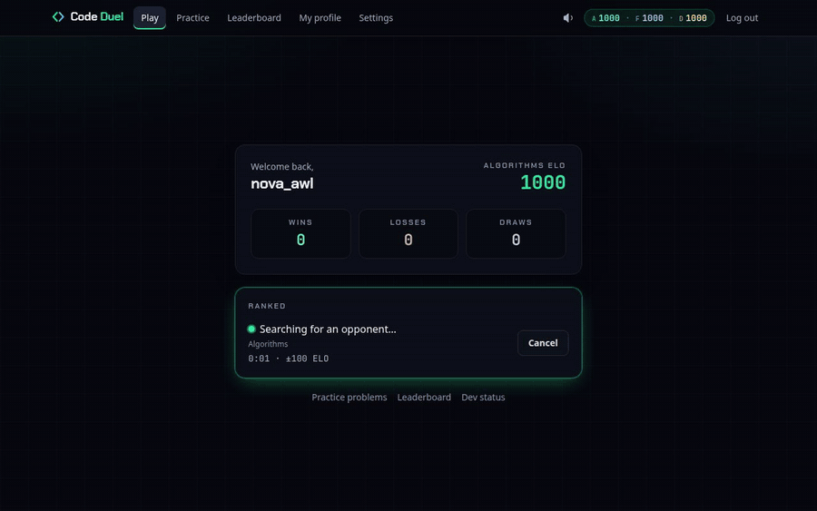

</div>

## Screenshots

| Landing page                                            | Arena, mid-match                                 |
| ------------------------------------------------------- | ------------------------------------------------ |
| 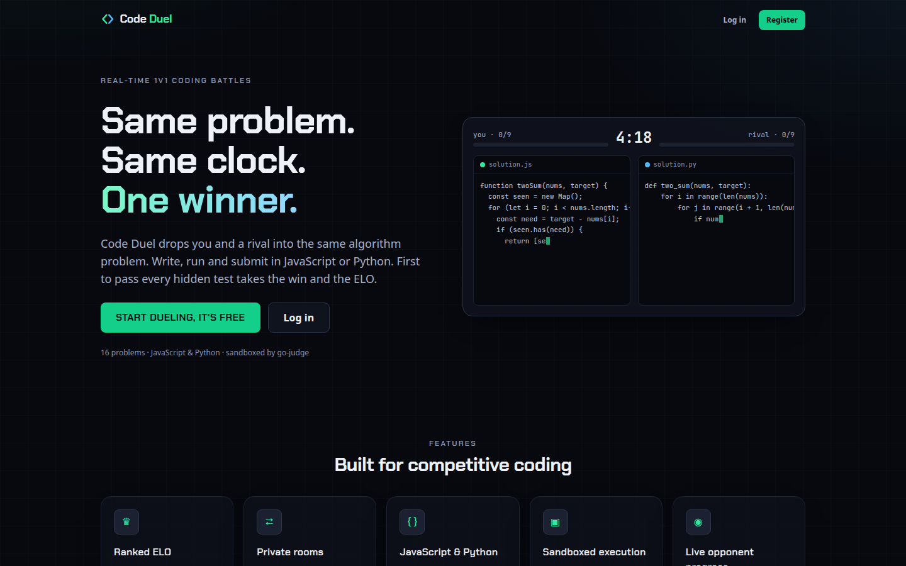           | 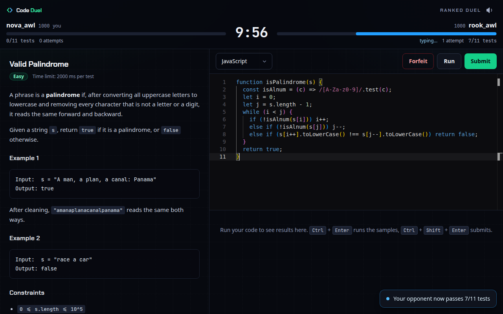   |
| **Result dialog**                                       | **Leaderboard**                                  |
| 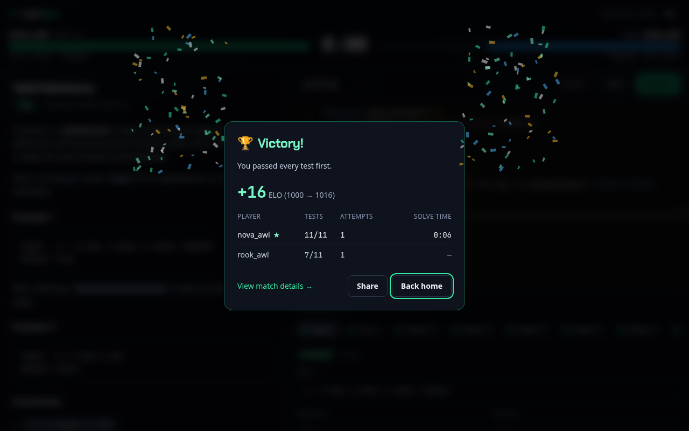           | 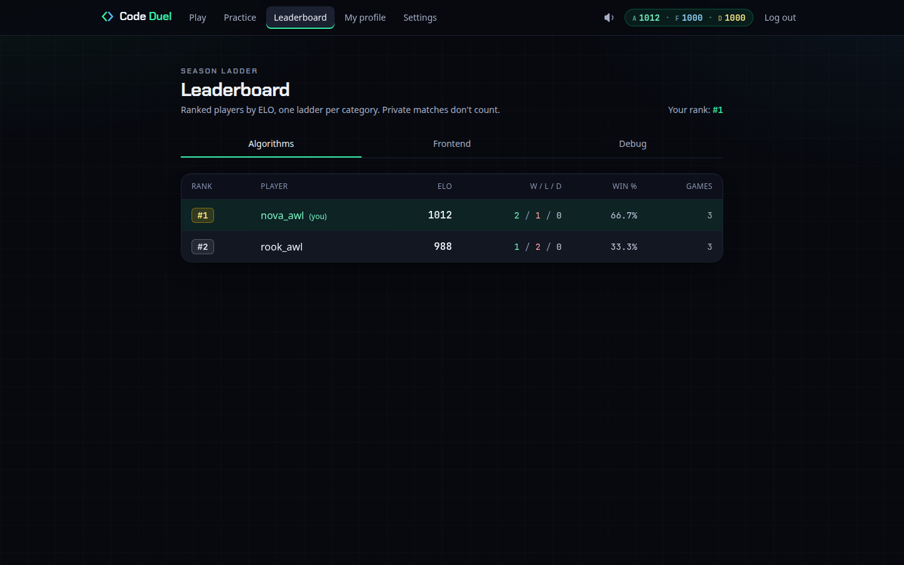 |
| **Profile with ELO history**                            | **Practice mode**                                |
| 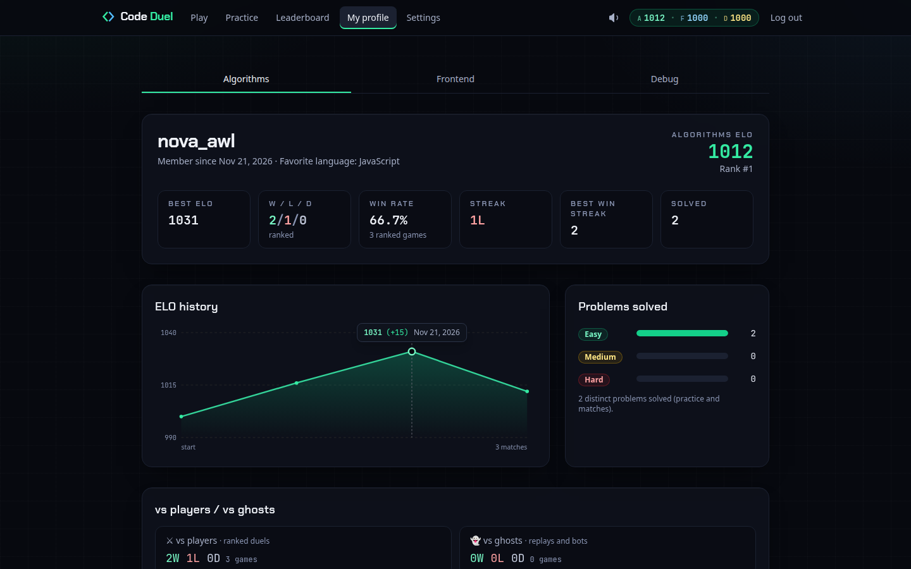 | 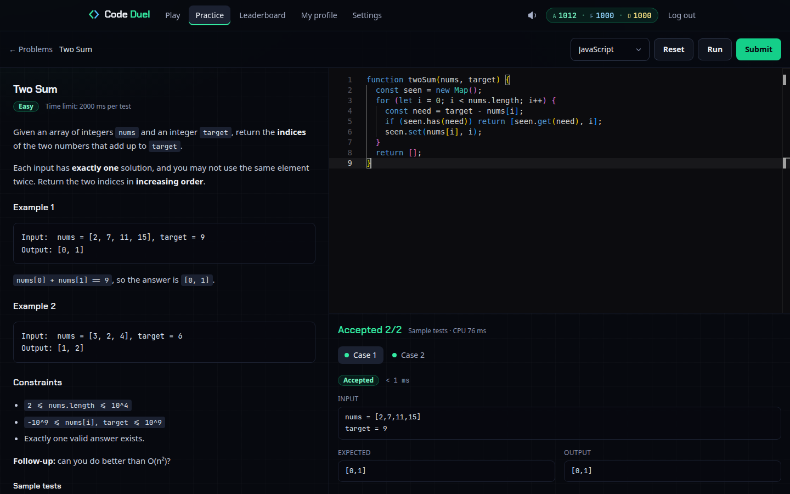  |

**Frontend practice:** the target with its palette, the HTML/CSS editor, and your live preview with
the official diff (red = pixels that differ) after a submit.

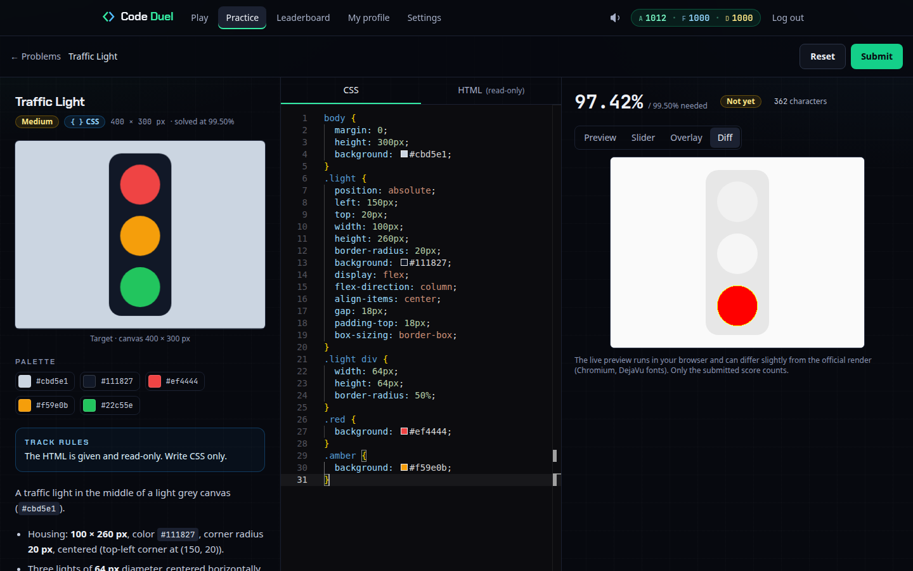

| **Debug practice:** buggy code, live lines changed     | **Ghost duel:** a replay, always labelled as one |
| ------------------------------------------------------ | ------------------------------------------------ |
| 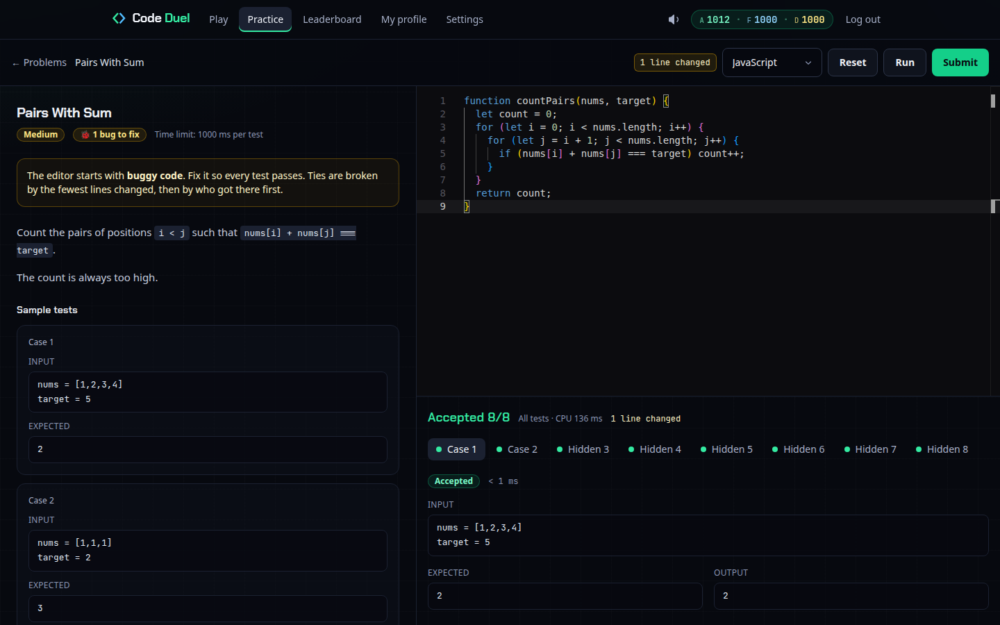 | 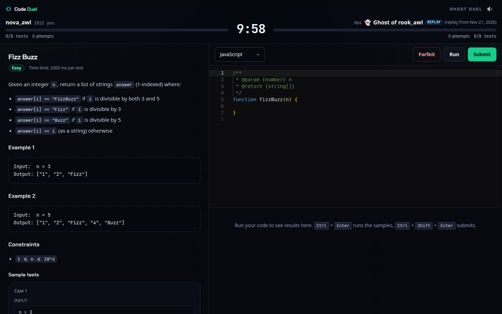  |

**Share card** (1200×630 link preview, also rendered as a 1080×1920 story):

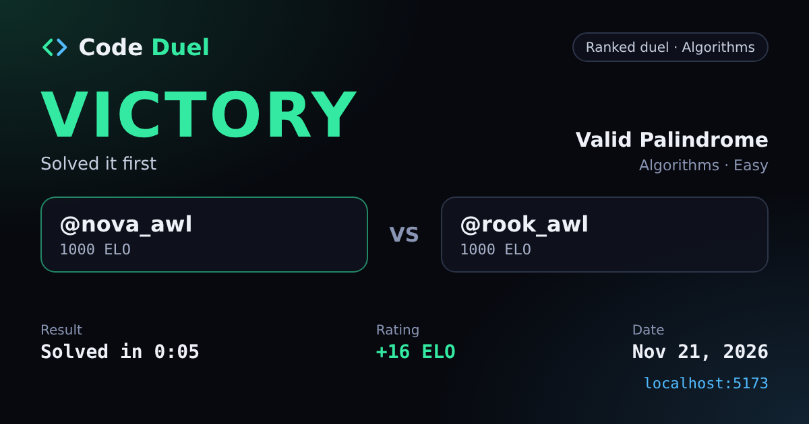

<p align="center">
  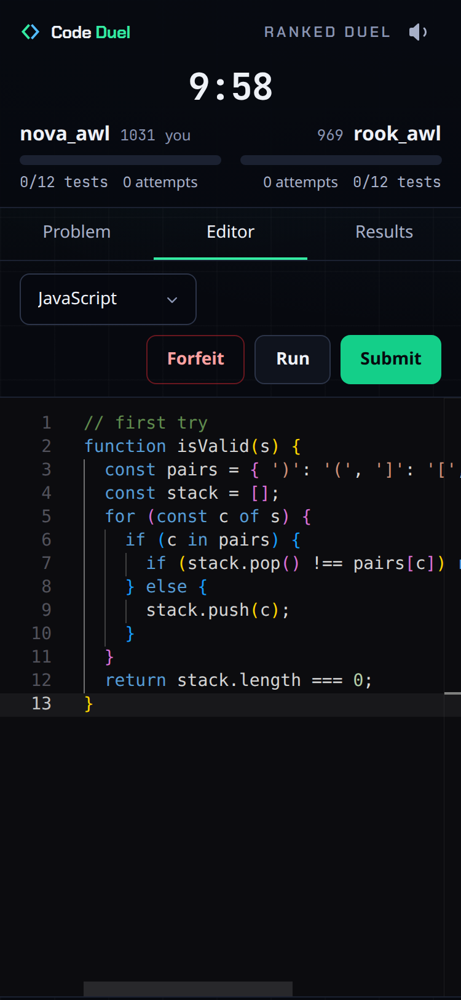<br>
  <em>The arena at 375 px: Problem / Editor / Results tabs.</em>
</p>

## Features

- **Ranked duels:** a matchmaking queue with a widening ELO window, ELO (K = 32) and W/L/D,
  and problem difficulty picked from the players' average rating.
- **Private rooms:** a 6-character code or invite link, unranked, with a rematch flow.
- **Live arena:** the server-owned timer, both players' test progress, an "opponent is typing"
  indicator, and Run (samples) / Submit (everything) in JavaScript or Python with Monaco.
- **16 algorithm problems** (5 easy, 7 medium, 4 hard), each with 2 samples and 8+ hidden tests.
  Hard problems include large inputs that time out O(n²) solutions.
- **18 frontend problems** in 3 tracks:
  - **HTML:** structure only, no CSS.
  - **CSS:** the HTML is given, write the CSS.
  - **HTML + CSS:** build the whole component.

  Each problem shows the target, its palette (click to copy) and the canvas size. The editor has
  a sandboxed live preview with compare tools: a slider, a 50 % overlay and the official diff.

- **10 debug problems** (4 easy, 4 medium, 2 hard) with realistic bugs: off-by-one, `>` vs
  `>=`, integer division, Python's mutable default argument, sorting numbers as strings, `===` on
  floats, mutating the input, shadowing, a missing `return`, wrong loop bounds. The seed proves,
  in both languages, that each buggy version fails and each fix passes.
- **Ghost and bot opponents:** after 20 s in the queue (or from Home), race a replay of a real
  player's past ranked run at the recorded times, or one of 4 bots when there is none. Always
  shown as "👻 Ghost of @user (replay from <date>)" or "🤖 Bot <name>"; K=16, and only your
  rating changes. Players can opt out of being replayed.
- **Share cards:** a result card (link preview and story formats) rendered by the sandboxed
  renderer, with a public `/s/<id>` page (Open Graph tags), Web Share, WhatsApp, downloads and
  revocable links.
- **Separate ratings per category:** ALGO, FRONTEND and DEBUG each have their own ELO, W/L/D,
  leaderboard, profile stats and ELO chart.
- **Practice mode:** the same judge and renderer, with no opponent.
- **Leaderboard, profiles and match details:** ranks with ties, a hand-drawn SVG ELO chart,
  streaks, solved-by-difficulty, a submission timeline, and both final codes (after the match).
- **Game feel:** a "match found" animation, a 3-2-1 countdown, a sound and toast when the
  opponent passes more tests, and confetti on a win. Every sound is synthesized with the Web Audio
  API. There's a mute toggle, and `prefers-reduced-motion` is respected.
- **Accounts:** httpOnly JWT cookie sessions, a password change, "log out of all devices"
  (token versioning revokes HTTP sessions and live sockets), and a default editor language.
- **Polish:** an "arena night" design system, self-hosted fonts, skeletons, empty and error states
  with Retry, a reconnecting banner, keyboard navigation, route-level code splitting, and
  Lighthouse **95–96 / 100 / 100** (Performance / Accessibility / Best Practices).

## Architecture

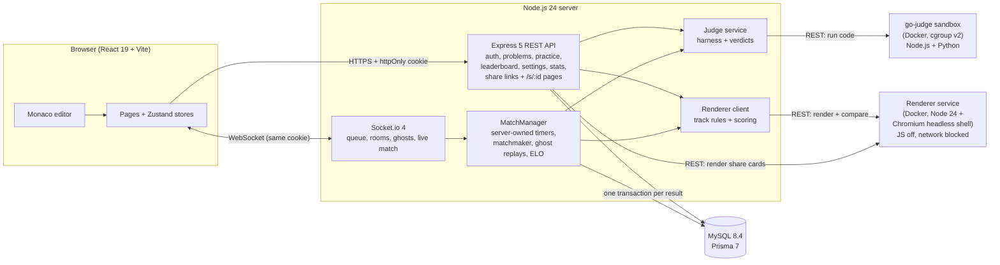

## The hard parts

- **Ghosts that never pretend to be people:** a ghost replays only the progress of a real ranked
  run (tests passed, score, lines changed) at the recorded offsets, on the server clock. No code is
  replayed or shown. Every payload carries a `ghost: { kind: 'ghost' | 'bot', … }` descriptor, the
  UI always labels it, and there is no typing indicator or online/offline state for it. Private
  matches and players who opted out are never used.

- **Running untrusted code safely:** every run executes in a nested
  [go-judge](https://github.com/criyle/go-judge) sandbox (Linux namespaces, seccomp, cgroup v2):
  - an empty network namespace;
  - read-only runtimes and small tmpfs scratch space;
  - CPU, wall-clock, 256 MB memory and 32-process limits;
  - 64 KB output caps.

  The go-judge API listens on localhost only. The integration tests attack it for real: infinite
  loops, huge allocations, network access and host file reads.

- **Hidden tests stay hidden:** hidden inputs and expected outputs never leave the server. Hidden
  results carry only `{ index, status, timeMs }`, with no logs or errors (they could echo the
  input). The tests check every REST response and every socket event, even when user code prints
  stdin, dumps its memory or escapes the JS `vm`.
- **The server owns the clock:** the countdown, match deadline, disconnect grace and room expiry
  all run on the server. Clients only render `endsAt`, corrected for clock skew. Tiebreaks
  ("who reached that test count first") use server timestamps.
- **Reconnect grace:** after a refresh or network drop, a player has 30 s to come back while the
  match keeps running. On reconnect, the client gets a full `match:state` snapshot, and its code
  is restored from `localStorage`.
- **ELO in one transaction:** the match row and both players' ELO and W/L/D are updated
  atomically, so the result is never half-written. Ranked only: private rooms can't be used to
  farm rating.
- **Rendering untrusted HTML/CSS:** the renderer service renders each submission in a fresh
  Chromium page:
  - JavaScript is disabled, and `<script>`, `<iframe>`, `<object>`, `<embed>`, `<link>`,
    `<meta http-equiv>` and `on*` handlers are stripped first by the browser's own parser;
  - every network request is aborted, with a strict CSP and a black-hole proxy as backups;
  - 5 s per render, at most 2 pages at a time, 20 KB of code, a read-only container with no
    capabilities.

  Targets are generated by rendering each reference solution with the same renderer, so the
  reference always scores exactly 100.00.

- **Session revocation with stateless JWTs:** each token carries `tokenVersion`. A password change
  or "log out of all devices" increments it, rejects old tokens over HTTP, and disconnects that
  user's older sockets right away.

## Tests

**330 tests in 29 files, all passing.** They run against a real MySQL test database and
the real go-judge and renderer containers:

- Unit tests: the judge, harnesses, ELO, the matchmaker and the match state machine (with fake
  timers).
- API tests: auth, settings, problems, practice, leaderboard, profiles and match details.
- Socket integration tests: full duels between two real clients, including reconnects and
  revocation.
- Seed checks: every reference solution passes, and naive solutions time out on hard problems.
- Renderer integration: references score 100.00, a `<script>` can't paint the page, external
  URLs never load, a too-slow page fails cleanly. Track rules, FRONTEND duel rules, and the
  rating migration on a scratch database.
- Debug: every seeded buggy version fails and every fix passes (both languages, real judge),
  lines-changed diffs, timeout tiebreaks, isolated ratings, a real-socket ranked debug duel.
- Ghosts and bots (fake timers): replay timing, who wins, timeout comparison, K=16 for the human
  only, bot fallback, opt-out / private / own-run exclusion (real query), honest payloads.
- Share cards: participants only, finished only, unguessable ids, revoke → 404, absolute Open
  Graph URLs, both PNG sizes, HTML escaping.

Details in [Tests](#tests-1).

## Run it locally

You need Node.js 24, Docker with Compose v2, and a Linux host with cgroup v2:

```bash
npm install
cp infra/.env.example infra/.env && cp server/.env.example server/.env   # then set real secrets
npm run infra:up      # MySQL + go-judge + renderer
npm run db:migrate    # schema
npm run db:seed       # 16 algorithm + 10 debug problems (checked through go-judge) + 18 frontend targets
npm run dev           # http://localhost:5173
```

The full walkthrough is in [Setup](#setup).

---

<p align="center">
  Built by <strong>Said El Fariss</strong> ·
  <a href="https://github.com/ElFarisssaid19/code-duel">github.com/ElFarisssaid19/code-duel</a>
</p>

---

# Technical documentation

## Tech stack

| Layer   | Tools                                                                                                   |
| ------- | ------------------------------------------------------------------------------------------------------- |
| Client  | React 19, Vite 8, Tailwind CSS 4, React Router 8, Zustand, Socket.io client, Monaco, marked + DOMPurify |
| Server  | Node.js 24, Express 5, Socket.io 4, Prisma 7 (MariaDB driver adapter), Zod 4                            |
| Data    | MySQL 8.4 (Docker)                                                                                      |
| Judge   | go-judge 1.14 (Docker, cgroup v2) with Node.js 26 LTS and Python 3.13 runtimes                          |
| Render  | Renderer service (Docker): Node.js 24 slim, Playwright 1.65 Chromium headless shell, pixelmatch, pngjs  |
| Auth    | bcryptjs, JWT (jose) in an httpOnly cookie, express-rate-limit                                          |
| Testing | Vitest, supertest, socket.io-client                                                                     |
| Tooling | npm workspaces, ESLint 10 (flat config), Prettier 3, concurrently                                       |

## Prerequisites

- **Node.js 24** (`.nvmrc` pins it: run `nvm use`) and npm 11
- **Docker Engine** with the **Compose v2 plugin** (`docker compose`, not `docker-compose`)
- Your user can run `docker` without sudo
- Free ports: 5173, 4000, 3306, 5050, 5070
- About 2.5 GB of disk for the Docker images (MySQL ~1.1 GB, renderer 820 MB, go-judge 400 MB)
- Linux host with cgroup v2 (the default on current distros); see [go-judge setup](#go-judge-setup)

## Setup

```bash
# 1. Install all workspaces (this also generates the Prisma client)
npm install

# 2. Create env files from the examples, then set real secrets
cp infra/.env.example infra/.env          # MySQL credentials
cp server/.env.example server/.env        # DATABASE_URL must match infra/.env
cp client/.env.example client/.env.local  # optional, everything has a default
cp server/.env.test.example server/.env.test  # only needed for `npm test`

# 3. Build/start MySQL, go-judge and the renderer, and wait until all three are healthy
npm run infra:up

# 4. Apply migrations (and regenerate the Prisma client)
npm run db:migrate

# 5. Seed the problems: algorithm reference solutions are checked through go-judge, frontend
#    targets are rendered (server/data/targets/) and verified with the renderer
npm run db:seed

# 6. Start the client and the server
npm run dev
```

Open <http://localhost:5173>. Logged out, `/` is the **landing page** (live public stats, a mock
duel). Register and the same URL becomes the **home page**, where you can **Play ranked**, create
or join a **private room**, or practice. The navbar links to Practice, the Leaderboard, your
profile and Settings. See [Pages](#pages). The dev dashboard at
<http://localhost:5173/dev/status> shows the API, database, judge, renderer, session and socket
state (the socket only connects while you're logged in).

Generate secrets with `openssl rand -hex 24` (DB passwords) and `openssl rand -hex 64`
(`JWT_SECRET`). Use hex or other URL-safe characters for the MySQL password, because it is also
part of `DATABASE_URL`.

## Scripts

Run all of these from the repo root.

| Script                 | What it does                                                         |
| ---------------------- | -------------------------------------------------------------------- |
| `npm run dev`          | Starts server (`node --watch`) and client (Vite) with `concurrently` |
| `npm test`             | Server test suite (Vitest + supertest) against `code_duel_test`      |
| `npm run lint`         | ESLint over the whole monorepo                                       |
| `npm run lint:fix`     | ESLint with auto-fix                                                 |
| `npm run format`       | Prettier: format every file                                          |
| `npm run format:check` | Prettier: check only (good for CI)                                   |
| `npm run infra:up`     | Builds (if needed) and starts MySQL, go-judge and the renderer       |
| `npm run infra:down`   | Stops them (MySQL data stays in the `code-duel-mysql-data` volume)   |
| `npm run infra:logs`   | Follows the logs of all containers                                   |
| `npm run db:up`        | Alias of `infra:up`                                                  |
| `npm run db:down`      | Alias of `infra:down`                                                |
| `npm run db:logs`      | Follows MySQL logs only                                              |
| `npm run db:migrate`   | `prisma migrate dev`, then `prisma generate`                         |
| `npm run db:seed`      | Verifies and upserts all problems, renders targets (idempotent)      |
| `npm run db:generate`  | Regenerates the Prisma client into `server/src/generated/prisma`     |
| `npm run db:studio`    | Opens Prisma Studio (prints its URL)                                 |
| `npm run docs:icons`   | Regenerates the favicon set and `og-image.png` (needs `npm run dev`) |
| `npm run docs:capture` | Regenerates `docs/screenshots/*` and `docs/demo.gif` (see below)     |

Creating a named migration: `npm run db:migrate -- --name add_something`.
Wiping the database: `npm run infra:down -- -v` deletes the volume, then `npm run infra:up && npm run db:migrate && npm run db:seed`.

Workspace-only scripts: `npm run build -w client`, `npm run preview -w client` (serves the
production build on port 4173, proxying `/api` and `/socket.io` to port 4000),
`npm run start -w server`, `npm run db:deploy -w server` (`prisma migrate deploy`, for
production).

## Ports

| Service             | Port | URL                              |
| ------------------- | ---- | -------------------------------- |
| Client (Vite)       | 5173 | http://localhost:5173            |
| Client (preview)    | 4173 | http://localhost:4173            |
| Server (Express/WS) | 4000 | http://localhost:4000/api/health |
| MySQL               | 3306 | localhost only                   |
| go-judge API        | 5050 | http://localhost:5050/version    |
| Renderer API        | 5070 | http://localhost:5070/health     |

In development the Vite server proxies `/api`, `/socket.io` (WebSocket included) and the public
share pages `/s/*` to port 4000,
so the browser talks to one origin and doesn't need CORS.

## Environment variables

**`infra/.env`**: `MYSQL_ROOT_PASSWORD`, `MYSQL_DATABASE`, `MYSQL_USER`, `MYSQL_PASSWORD`,
`MYSQL_PORT`, `JUDGE_PORT` (go-judge, default 5050), `RENDERER_PORT` (renderer, default 5070;
not 5060/5061: `fetch()` refuses those ports).

**`server/.env`**: validated with Zod at startup (`server/src/config/env.js`). If a value is
missing or invalid, the server exits with a clear error.

| Variable            | Example                                                                                                            |
| ------------------- | ------------------------------------------------------------------------------------------------------------------ |
| `PORT`              | `4000`                                                                                                             |
| `NODE_ENV`          | `development` / `test` / `production`                                                                              |
| `CLIENT_URL`        | `http://localhost:5173` (CORS origin)                                                                              |
| `DATABASE_URL`      | `mysql://codeduel:<password>@localhost:3306/code_duel?allowPublicKeyRetrieval=true`                                |
| `JWT_SECRET`        | 32+ random characters                                                                                              |
| `JUDGE_URL`         | `http://localhost:5050` (go-judge REST API)                                                                        |
| `JUDGE_PROVIDER`    | `gojudge` (default; see [Judge architecture](#judge-architecture))                                                 |
| `RENDERER_URL`      | `http://localhost:5070` (default; the renderer service)                                                            |
| `RENDERER_PROVIDER` | `playwright` (default; see [Renderer](#renderer-service))                                                          |
| `DATA_DIR`          | `data` (default, relative to `server/`): target images (`targets/`) and cached share cards (`cards/`)              |
| `APP_URL`           | `http://localhost:5173` (default): public URL of the app, used for share links and Open Graph tags (absolute URLs) |

**`server/.env.test`**: same variables, used only by `npm test`. `DATABASE_URL` must point to a
database whose name ends in `_test` (default `code_duel_test`). Tests write target images to a temp
directory, never to `server/data`.

**`client/.env.local`**: `VITE_API_URL` and `VITE_SOCKET_URL`. Leave both empty in development.

## Authentication

### Endpoints

All under `/api/auth`. Bodies are JSON. Every user object contains only public fields:
`id`, `username`, `email`, `preferredLanguage`, `allowGhosts`, `ghostNoticeDismissed`, `createdAt`,
and the ratings:
`ratings: { ALGO: { elo, wins, losses, draws, bestElo }, FRONTEND: { … }, DEBUG: { … } }`. The top-level `elo`,
`wins`, `losses` and `draws` are the ALGO rating, kept for compatibility. `passwordHash` and
`tokenVersion` are never returned.

| Method | Path        | Body                            | Success                            | Errors        |
| ------ | ----------- | ------------------------------- | ---------------------------------- | ------------- |
| POST   | `/register` | `{ username, email, password }` | `201 { user }` + session cookie    | 400, 409, 429 |
| POST   | `/login`    | `{ identifier, password }`      | `200 { user }` + session cookie    | 400, 401, 429 |
| POST   | `/logout`   | none                            | `204`, clears the cookie           | none          |
| GET    | `/me`       | none (needs the cookie)         | `200 { user }`                     | 401           |
| GET    | `/session`  | none                            | `200 { user }` or `{ user: null }` | none          |

- `username`: 3–20 characters, letters, numbers and `_`. Unique, case-insensitive
  (MySQL's default collation), so `Alice` and `alice` can't both exist.
- `email`: valid address, trimmed and stored lowercased.
- `password`: at least 8 characters and at most 72 bytes (bcrypt ignores anything past 72 bytes,
  so longer passwords are rejected instead of silently truncated). Hashed with bcryptjs, cost 12.
- `identifier`: a username or an email (anything containing `@` is treated as an email).
- `/register` and `/login` are rate-limited to **10 requests per 15 minutes per IP** (each route
  counts separately, in memory, reset on server restart).
- `/session` is what the client calls on load: it answers 200 for guests too, so a logged-out
  visit doesn't log a 401 in the browser console. `/me` keeps its 401 for API clients.

### Error format

Every error response has the same shape:

```json
{
  "error": {
    "code": "VALIDATION_ERROR",
    "message": "Invalid request data",
    "details": { "username": ["Username must be at least 3 characters"] }
  }
}
```

| Status | `code`                     | When                                                                             |
| ------ | -------------------------- | -------------------------------------------------------------------------------- |
| 400    | `VALIDATION_ERROR`         | Zod validation failed; `details` maps each field to its messages                 |
| 400    | `INVALID_JSON`             | Malformed JSON body                                                              |
| 400    | `INVALID_CURRENT_PASSWORD` | Password change with a wrong current password (`details.currentPassword`)        |
| 401    | `INVALID_CREDENTIALS`      | Wrong login. Same response whether or not the account exists                     |
| 401    | `UNAUTHORIZED`             | Missing, invalid or expired session                                              |
| 404    | `NOT_FOUND`                | Unknown route                                                                    |
| 409    | `CONFLICT`                 | Username or email taken, e.g. `details: { "email": ["Email is already taken"] }` |
| 429    | `RATE_LIMITED`             | Too many login/register/password-change attempts                                 |
| 500    | `INTERNAL_ERROR`           | Anything unexpected (message hidden in production)                               |

Throw `new HttpError(status, code, message, details?)` (`server/src/lib/errors.js`) from any route
to produce one of these.

### Sessions and cookies

- On register/login the server signs a **JWT** (HS256, `JWT_SECRET`, subject = user id, expires
  in **7 days**) and sets it in a cookie named **`token`**: `HttpOnly` (JavaScript can't read it,
  which protects it from XSS), `SameSite=Lax` (not sent on cross-site POSTs, which blocks CSRF),
  `Path=/`, `Max-Age` 7 days, and `Secure` only when `NODE_ENV=production` (so it works over
  plain HTTP on localhost).
- The browser sends the cookie automatically, so the client never handles the token. In
  development, Vite proxies `/api` and `/socket.io`, so everything is same-origin.
- `requireAuth` (`server/src/middleware/requireAuth.js`) verifies the cookie, loads the user from
  the database and sets `req.user` (public fields). A deleted user's token stops working
  immediately.
- **Token versioning:** the JWT carries `ver`, the user's `tokenVersion` when it was signed.
  `requireAuth` and the socket handshake reject a token whose `ver` is older than the current
  `tokenVersion` (tokens from before versioning count as version 0). See
  [Settings and session revocation](#settings-and-session-revocation).
- **Logout** clears this browser's cookie only. Other sessions stay valid until they expire or the
  user changes their password or uses "Log out of all devices". Rotating `JWT_SECRET` logs
  everyone out.
- Auth responses are sent with `Cache-Control: no-store`.

### Socket.io

The Socket.io handshake is authenticated with the same cookie
(`server/src/socket/authMiddleware.js`). Unauthenticated connections are rejected with a
`connect_error` whose `message` is `Unauthorized: …` and whose `data` is
`{ code: 'UNAUTHORIZED', message }`. Accepted sockets have `socket.data.user` (public fields), and
the server emits a `session` event with `{ user }` right after connecting. Each socket joins a
per-user room (`user:<id>`), so server events reach all of a user's tabs. Duel events are listed
in [Socket events](#socket-events). When a user's sessions are revoked, every socket of theirs
holding an older token gets `session:revoked` and is disconnected by the server.

### Client

- `store/authStore.js` (Zustand) holds `user` and `status` (`loading` → `authenticated` |
  `guest`). `fetchMe()` runs once on app load, so the session survives a page refresh.
- `ProtectedRoute` sends guests to `/login` (and back to the page they wanted after logging in).
  `GuestRoute` sends logged-in users away from `/login` and `/register`.
- `hooks/useSocketLifecycle.js` connects the socket only while authenticated and disconnects it
  on logout. When the server disconnects the socket, it checks `/api/auth/session`: if the session
  is still valid (e.g. this tab just changed the password and got a fresh cookie), it reconnects.
  Otherwise it sends the user to `/login` with "You were logged out because your session was
  ended on another device."
- `store/connectionStore.js` tracks the socket state; `ConnectionBanner` shows "Connection lost.
  Reconnecting…" while a socket that was connected is trying to come back.

## Tests

The server test suite (Vitest + supertest + socket.io-client): **330 tests in 29 files**.

- **Unit tests**: output comparison, go-judge status mapping and request units, harness generation,
  verdict building and sample/hidden merging (`test/judge/`). Also duels (`test/match/`), using
  Vitest fake timers, a fake repository and a mocked judge: win by solve, timeout rules and
  tiebreak, draw, forfeit, disconnect grace / reconnect / timeout, one activity per user, no
  self-play, unranked private rooms, ELO math, matchmaking window, room expiry, rematch, and
  server-start cleanup (against the test DB).
- **Judge integration tests** (`test/judge/judge.integration.test.js`): against the **real
  go-judge container**, in JavaScript and Python. They cover accepted, wrong answer, syntax error,
  runtime error, infinite loop, huge allocation, blocked network, and no access to host files.
- **API tests**: auth, sockets, problems and practice. They check that hidden test data never
  appears in any response, even when user code prints stdin, dumps its memory or escapes the JS
  `vm`. They also cover the run/submit rate limit and saved submissions.
- **Stats tests** (`test/stats.test.js`, `test/matchDetails.test.js`): leaderboard order, tie
  ranks, exclusions, pagination and your off-page rank. Profile stats (win rate, streaks, best ELO,
  favorite language, solved by difficulty with duplicates, private matches excluded), the ELO
  history, and match history. An N+1 check counts SQL queries for 3 vs 30 matches. Match details:
  code hidden from non-participants, 403 while a match isn't finished, visible to participants
  after it, and no hidden test data anywhere.
- **Seed tests** (`test/seed.test.js`, real go-judge): all 16 problem definitions are valid, every
  reference solution passes in both languages, and a naive O(n²) solution times out on at least
  one hidden test of each HARD problem.
- **Duel integration tests** (`test/match/duel.integration.test.js`): two real socket.io-client
  connections against the real server, MySQL and go-judge. Covers a full ranked match with ELO in
  the DB, a private room with rematch, rejoin after a disconnect, the disconnect loss, and a scan
  of every event and ack payload proving hidden test data never appears.
- **Frontend tests** (`test/frontend/`, `test/match/frontendDuel.test.js`,
  `test/ratingMigration.test.js`):
  - **Renderer integration** (real container): references score 100.00 deterministically; an
    empty page scores 0 (raw ratio > 95 % on sparse pages); a `<script>`, a `</style>` break-out
    and event handlers can't change the page; external `url()`, `@import`, `<iframe>` and ``
    never load; a page that takes too long fails with `RENDER_TIMEOUT` after 5 s, and the
    renderer still works afterwards; code over 20 KB is refused.
  - **Track rules** for all three tracks: CSS / `<style>` / `style=` / `<link>` in HTML, HTML in
    CSS, embedded images, empty code, character counting.
  - **Duel rules** with the renderer mocked:
    - matchmaking per category and track, with the FRONTEND rating;
    - threshold win, best score on timeout (a worse resubmission doesn't count);
    - the character tiebreak, then the earlier submission; draw at 0;
    - only FRONTEND ratings change; opponents never see code or diffs.
  - **API:** category filters, the brief (no reference), target images, practice submit (partial
    → below the threshold with a diff, reference → solved), track errors, category-aware
    leaderboard / profile / history, match previews (hidden while live) and code.
  - A real-socket ranked FRONTEND duel.
  - The canvas document of the live preview matches the renderer's.
  - **Rating migration** on a scratch database: users keep their ELO / W/L/D / best ELO in ALGO,
    FRONTEND starts at 1000.
- **Debug tests** (`test/debug/`): lines changed (including the client copy); every seeded
  problem's buggy code fails a sample and a hidden test and its fix passes, in both languages
  (real go-judge); 6/10/15-minute durations; timeout tiebreaks (tests → lines changed → earlier
  submission → draw at 0); DEBUG ratings isolated from ALGO and FRONTEND; API and a real-socket
  ranked debug duel.
- **Ghost and bot tests** (`test/match/ghosts.test.js`, `test/ghostPool.test.js`): with fake
  timers, the replay fires at the recorded offsets; the ghost wins when it solves first, the human
  when faster; timeout comparison; K=16 and only the human's rating changes; leaving and
  disconnecting are losses; the bot fallback on an empty pool; the 20 s queue offer; payloads
  always carry the ghost/bot descriptor (no connection state, no typing). On the real database:
  own runs, opted-out users, private matches and runs without submissions are excluded; the
  Settings toggle; history, breakdown and match details flag ghosts and never show their code.
- **Share tests** (`test/share.test.js`, real renderer): participants only, finished matches only,
  one unguessable id per user per match (also under concurrent requests), the rate limit, revoke →
  404 (page and cards), absolute Open Graph / Twitter URLs, both PNG sizes, no code or test data
  on the page, and HTML escaping (a `<script>` username is text).
- **Settings and public stats tests** (`test/settings.test.js`): `GET /api/stats/public` needs
  no auth and is cached for 60 s. Password change: requires the current password, validates the
  new one like register, keeps this session with a fresh cookie, rejects the old token afterwards
  and is rate-limited. "Log out of all devices" and normal logout, legacy tokens without `ver`,
  `GET /api/auth/session` and preferences. Socket revocation: other sessions' sockets are
  disconnected and an old token is rejected at the handshake, while other users stay connected.

```bash
cp server/.env.test.example server/.env.test   # once; set the same DB password as server/.env
npm run infra:up                               # MySQL AND go-judge must be running
npm test                                       # or: npm run test:watch -w server
```

- Tests use a separate database, **`code_duel_test`**. It's created and migrated automatically
  (`prisma migrate deploy`) before the run; your dev data isn't touched.
- Every table is emptied before each test, so the setup refuses to run unless the database name
  ends in `_test`.
- Test files run one at a time because they share the database.

## go-judge setup

[go-judge](https://github.com/criyle/go-judge) ([docs](https://docs.goj.ac)) runs user code in
nested Linux containers with namespaces, cgroup v2 limits and seccomp. It works on cgroup v2
hosts out of the box: no GRUB changes, no VM.

`infra/go-judge/` builds a custom image following the official multi-stage pattern:

- `Dockerfile`: copies the go-judge binary from `criyle/go-judge:v1.14.1` into `debian:trixie-slim`
  with **Node.js 26.13.1 LTS** (binary from the official `node` image) and **Python 3.13**.
- `mount.yaml`: what the sandbox can see. `/bin`, `/lib`, `/usr` are bind-mounted **read-only**.
  `/w` (the working dir) and `/tmp` are small tmpfs mounts. Nothing else from the image or the
  host is visible.
- `passwd`: a fixed 3-line `/etc/passwd` for the sandbox.

The compose service (`infra/docker-compose.yml`) runs it **privileged** (required: go-judge creates
nested containers and cgroups), with `shm_size: 256m` (its file store lives in `/dev/shm`), bound to
**127.0.0.1:5050 only**, with a healthcheck on `GET /version`.

```bash
npm run infra:up                    # builds the image the first time (~2 min), then starts it
curl -s localhost:5050/version      # {"buildVersion":"v1.14.1",...}
curl -s localhost:5050/config | grep -o '"cgroupType":[0-9]'   # "cgroupType":2
```

> **Security:** anyone who can reach port 5050 can run code. Never expose it beyond localhost or
> a private network.

### Sandbox limits (per run)

| Limit             | Value                                                                                                        |
| ----------------- | ------------------------------------------------------------------------------------------------------------ |
| CPU time          | `timeLimitMs` per test (enforced by the harness) + a whole-run cap of `timeLimitMs × tests + 1 s` (max 20 s) |
| Wall clock        | 2 × CPU cap + 1 s (catches `sleep` and blocking calls)                                                       |
| Memory            | 256 MB (cgroup); Node's heap is capped to match                                                              |
| Processes/threads | 32                                                                                                           |
| stdout / stderr   | 64 KB each (more = runtime error "Output limit exceeded")                                                    |
| Network           | none: the sandbox has its own empty network namespace                                                        |
| Filesystem        | read-only runtimes; writable `/w` and `/tmp` tmpfs (64 MB each)                                              |

go-judge units: `cpuLimit`/`clockLimit` are nanoseconds, `memoryLimit` is bytes
(`server/src/services/judge/providers/gojudge.js`).

## Judge architecture

```
POST /api/practice/:slug/run|submit
  → practice.service      loads the problem + tests (samples only for "run")
  → judge/index.js        judgeSolution(): picks the provider from JUDGE_PROVIDER
  → judge/evaluate.js     builds the harness run, calls runCode, compares outputs
  → judge/harness.js      files: main.{js,py} (harness) + solution.{js,py} (user code); stdin: inputs
  → providers/gojudge.js  POST /run to go-judge, maps statuses, deletes any cached files
```

- **Provider interface** (`server/src/services/judge/index.js`):
  `runCode({ language, files, stdin, timeLimitMs, memoryLimitMb, collectFiles? })` →
  `{ status, message, stdout, stderr, timeMs, memoryKb, exitCode, files }`. To use another engine,
  implement that in `providers/<name>.js`, register it in `PROVIDERS`, and set `JUDGE_PROVIDER`.
- **Function-style problems:** users write a function (`twoSum(nums, target)` /
  `two_sum(nums, target)`). The harness (`judge/harness/javascript.cjs`, `judge/harness/python.py`)
  runs inside the sandbox. It reads the inputs from stdin before any user code loads, calls the
  function once per test with that test's arguments, and writes one JSON line per test (actual
  value, error, console output as "logs", time) to a results file that the provider collects.
- **Samples and hidden tests run in separate sandbox executions** (`judgeSubmission`, in
  parallel). The hidden execution only receives hidden inputs and captures no logs, and its
  results are reduced to `{ index, status, timeMs }` inside the judge service. So nothing user code
  prints, returns or raises while it can see hidden inputs can reach a client, and sample logs
  can't contain hidden inputs. This applies to practice submit and to duels; "run" only executes
  samples.
- **All tests of one execution run in a single sandbox process.** Each test has its own time limit inside the harness
  (a `vm` timeout in JS, `SIGALRM` in Python), so an infinite loop or a thrown error in one test
  doesn't stop the others. If the process is killed (memory, or the whole-run CPU cap), the test
  in progress gets that status and the rest are `SKIPPED`.
- **Expected outputs never enter the sandbox.** The server compares actual vs expected
  (`judge/compare.js`): deep JSON equality, floats within `1e-6`, object key order ignored.
- **Statuses:** `ACCEPTED`, `WRONG_ANSWER`, `RUNTIME_ERROR`, `TIME_LIMIT_EXCEEDED`,
  `MEMORY_LIMIT_EXCEEDED`, `COMPILE_ERROR` (syntax errors, both languages), `INTERNAL_ERROR`, and
  `SKIPPED` (per test). The submission verdict is the first non-accepted test's status.
- **Known limitation (TODO in both harnesses):** user code runs in the same process as the harness,
  so it could forge result lines (fake a verdict). Thanks to the separate executions it can only
  read inputs of its own kind (sample code sees samples, hidden code sees hidden inputs but can't
  output anything). The sandbox contains it either way (no network, no host files, all limits
  apply). Planned hardening: one sandbox process per test, or signed result lines.

## Duels

Two players get the same problem; the server judges both with the same judge as practice. Every
match is one category: **ALGO** (tests passed, judged by go-judge), **DEBUG** (fix buggy code,
same judge; see [Debug category](#debug-category)) or **FRONTEND** (pixel score, rendered by the
renderer; see [Frontend category](#frontend-category)). A match can also be against a ghost or a
bot (mode `GHOST`; see [Ghost and bot opponents](#ghost-and-bot-opponents)). The rules below apply to
both, except where the frontend section says otherwise. Ranked matches only change the rating of
their category.

### Match rules

| Rule                | Details                                                                                                                                                                                                                                                                                                                                            |
| ------------------- | -------------------------------------------------------------------------------------------------------------------------------------------------------------------------------------------------------------------------------------------------------------------------------------------------------------------------------------------------- |
| Modes               | **RANKED**: matchmaking queue, updates ELO, wins/losses/draws. **GHOST**: against a replay or a bot, K=16, only the human's rating changes (see [Ghost and bot opponents](#ghost-and-bot-opponents)). **PRIVATE**: room code or invite link, **unranked** (no ELO or W/L/D change, so no ELO farming with friends).                                |
| One thing at a time | A user can be in only one queue, room or match, across all tabs (`ALREADY_BUSY`). Nobody can play against themselves.                                                                                                                                                                                                                              |
| States              | `WAITING` (both players found; waiting for both clients to join, max 30 s, otherwise `CANCELLED`) → `COUNTDOWN` (3 s) → `ACTIVE` → `FINISHED` or `CANCELLED`. Persisted on the `Match` row with `mode`, `endReason`, timings, ELO before/after and best progress.                                                                                  |
| Duration            | EASY 10 min, MEDIUM 15 min, HARD 20 min (DEBUG: 6 / 10 / 15 min). **The server owns every timer**; clients only display `endsAt` (corrected for clock skew with `serverNow`).                                                                                                                                                                      |
| Problem             | Avoids problems either player saw in their last 5 matches when possible. Ranked difficulty from the average ELO: < 1100 EASY, < 1300 EASY or MEDIUM, otherwise MEDIUM or HARD. If a band ever has no problems, any difficulty is used. Private: the host picks EASY / MEDIUM / HARD / ANY (a difficulty with no problems is rejected).             |
| Languages           | Each player picks JavaScript or Python and can switch at any time.                                                                                                                                                                                                                                                                                 |
| Run / submit        | `match:run` judges the samples only (no effect on progress). `match:submit` judges everything (samples and hidden in separate executions), counts an attempt, and is saved as a `Submission` with `matchId`. Together: 1 request per 3 s per player.                                                                                               |
| Winning             | First to pass **all** tests wins immediately (`SOLVED`). On **timeout**: most tests passed wins; if equal, whoever reached that count first; if both have 0, a draw (`TIMEOUT`). **Forfeit**: the other player wins (`FORFEIT`). **Disconnect**: 30 s grace to reconnect while the match keeps running, then the other player wins (`DISCONNECT`). |
| ELO                 | Ranked only. K = 32, expected score `1 / (1 + 10^((Rb − Ra) / 400))`, rounded, zero-sum (`server/src/services/elo.js`). Both users' ELO and W/L/D and the match row are updated in **one transaction**.                                                                                                                                            |
| Restart             | On server start, every `WAITING`/`COUNTDOWN`/`ACTIVE` match in the DB is marked `CANCELLED` (live state is in memory only).                                                                                                                                                                                                                        |

### Matchmaking

`server/src/services/match/matchmaker.js`, ticking every second:

- Each queued player has an ELO window that starts at **±100** and widens by **50 every 5 s**, up to
  **±500**. After **60 s** they can be paired with anyone.
- One queue per category: an ALGO player is never paired with a FRONTEND player. A FRONTEND player
  can pick a track (HTML, CSS, HTML + CSS) or "any track"; two players are compatible when the
  tracks match or one of them chose any track (the match then uses the chosen track).
- Two players are compatible when their ELO **in that category** differs by no more than the
  **wider** of their two windows.
- Oldest players are served first, each paired with the closest-rated compatible player.
- Leaving the queue, disconnecting or closing the last tab removes the player. Waiting players
  get `queue:status { elapsedMs, window, ghostOffer }` every second (`ghostOffer` turns true after
  20 s: the client then offers "Play a ghost now").
- The queue sits behind a small store interface (`add / remove / get / has / list`), so the
  in-memory store can be replaced by Redis.

### Private rooms and rematch

- Room codes are 6 characters from `ABCDEFGHJKLMNPQRSTUVWXYZ23456789` (no 0/O/1/I), case-insensitive.
  Rooms expire after **10 minutes** without a second player, and survive a host page refresh.
- Invite link: `/join/<code>`. A logged-out visitor logs in (or registers) first and is sent back.
- After a private match, either player can request a **rematch**; it starts when both accept
  (within 2 minutes), with a new problem of the same difficulty.

### Reconnecting

On refresh or network loss, the client emits `match:rejoin` again on every (re)connect and gets a
full `match:state` snapshot (status, problem, `endsAt`, remaining time, both players' progress,
result). The code is autosaved in `localStorage` per match and language. Opening the app with a
live match redirects to it.

### Socket events

All request/response events use acknowledgement callbacks and answer
`{ ok: true, data }` or `{ ok: false, error: { code, message } }`. Every payload is validated with zod
(`server/src/validators/match.schemas.js`).

| Client → server   | Payload                                                                                | Ack data                                                                                                             |
| ----------------- | -------------------------------------------------------------------------------------- | -------------------------------------------------------------------------------------------------------------------- |
| `state:get`       | none                                                                                   | `{ type: 'idle' \| 'queue' \| 'room' \| 'match', … }`: restores the UI / redirects to a live match                   |
| `queue:join`      | none (ALGO) or `{ category: 'ALGO' \| 'FRONTEND' \| 'DEBUG', track? }`                 | `{ status, category, track, elapsedMs?, window?, ghostOffer? }`                                                      |
| `queue:leave`     | none                                                                                   | `{ status: 'idle' }`                                                                                                 |
| `ghost:start`     | none (ALGO) or `{ category, track? }`; also accepted while queueing (leaves the queue) | `{ matchId, mode: 'GHOST', ghost }`: then `match:found`, like any match                                              |
| `room:create`     | `{ difficulty: 'EASY' \| 'MEDIUM' \| 'HARD' \| 'ANY', category?, track? }`             | room `{ code, difficulty, category, track, status, players, expiresAt }`                                             |
| `room:join`       | `{ code }`                                                                             | `{ code, matchId }`                                                                                                  |
| `room:leave`      | none                                                                                   | `{ status: 'idle' }`                                                                                                 |
| `match:rejoin`    | `{ matchId }`                                                                          | full snapshot (also emitted as `match:state`)                                                                        |
| `match:run`       | `{ language, code }` (ALGO only)                                                       | `{ matchId, result }`: samples only                                                                                  |
| `match:submit`    | ALGO `{ language, code }`, FRONTEND `{ html?, css? }`                                  | `{ matchId, result, submission, progress }`. FRONTEND `result`: `{ score, solved, threshold, charCount, diffImage }` |
| `match:forfeit`   | none                                                                                   | `{ matchId }`                                                                                                        |
| `match:activity`  | none (fire and forget, throttled)                                                      | none                                                                                                                 |
| `rematch:request` | `{ matchId? }`                                                                         | `{ matchId, status, requestedBy, newMatchId? }`                                                                      |

| Server → client                            | Payload                                                                                                                                                                                   |
| ------------------------------------------ | ----------------------------------------------------------------------------------------------------------------------------------------------------------------------------------------- |
| `queue:status`                             | `{ status: 'searching', elapsedMs, window, ghostOffer }` (`window: null` = anyone) or `{ status: 'idle' }`                                                                                |
| `room:update`                              | `{ code, difficulty, status: 'open' \| 'starting' \| 'closed', players, expiresAt, reason? }`                                                                                             |
| `match:found`                              | `{ matchId, mode }` (`mode: 'GHOST'` for ghost/bot matches)                                                                                                                               |
| `match:countdown`                          | `{ matchId, startsAt, serverNow }`                                                                                                                                                        |
| `match:start`                              | `{ matchId, problem (samples only), endsAt, serverNow, me, opponent: { username, elo, … } }`                                                                                              |
| `match:state`                              | snapshot on rejoin: status, problem, `endsAt`, `remainingMs`, `me`, `opponent`, result, rematch                                                                                           |
| `match:run:result` / `match:submit:result` | same payload as the ack (sent to all of the player's tabs)                                                                                                                                |
| `opponent:progress`                        | `{ userId, passed, total, attempts }` (DEBUG adds `linesChanged`; FRONTEND adds `score`, `threshold`: never code or previews). In ghost matches the replay sends it at the recorded times |
| `opponent:activity`                        | `{ at }`: "opponent is typing"                                                                                                                                                            |
| `opponent:connection`                      | `{ connected, graceEndsAt? }`                                                                                                                                                             |
| `match:end`                                | `{ matchId, mode, winnerId, reason, eloChanges: { [userId]: { before, after, delta } } \| null, summary }` (FRONTEND adds `category`; summary players have `score`, `charCount`)          |
| `rematch:update`                           | `{ matchId, status: 'pending' \| 'accepted' \| 'expired' \| 'cancelled', requestedBy }`                                                                                                   |
| `match:error`                              | `{ code, message }`: a match couldn't be created after pairing                                                                                                                            |

Hidden test inputs, expected outputs, logs and errors never appear in any event or ack (the
integration test scans all of them). The snapshot (`match:state`) also carries `category` and
`track`; for FRONTEND matches, `problem` is the frontend brief (target image URL, canvas, palette,
fixed HTML, track rules), never the reference solution.

### Testing a duel locally with two accounts

1. `npm run infra:up && npm run db:migrate && npm run db:seed && npm run dev`
2. Open <http://localhost:5173> in a normal window and register **player one**.
3. Open a **private/incognito window** (separate cookies) and register **player two**.
4. **Ranked:** click **Play ranked** in both windows. They're paired within a second (new accounts
   are both 1000 ELO), then a 3 s countdown starts. Solve the problem in one window (the reference
   solutions are in `server/prisma/seed/solutions/`).
5. **Private:** click **Create private room** in one window, then type the code in **Join room** in
   the other, or open the invite link (`/join/<code>`) there.
6. **Reconnect:** refresh a window during a match: timer, progress and code come back. Close a
   window for more than 30 s to lose by disconnect.

## Leaderboard, profiles and match details

### Pages

| Route                          | What it shows                                                                                                                                                                               |
| ------------------------------ | ------------------------------------------------------------------------------------------------------------------------------------------------------------------------------------------- |
| `/` (logged out)               | Landing page: hero with an animated mock duel, features, "how it works", live public stats, footer                                                                                          |
| `/` (logged in)                | Play: pick ALGO, FRONTEND (+ optional track) or DEBUG, ranked queue (with "Play a ghost now" after 20 s), "Play vs ghost", private rooms, join by code, your ELO and W/L/D for the category |
| `/problems`, `/practice/:slug` | Problem list with ALGO / FRONTEND tabs (`?category=`, track filter, track badges, best score) and the practice editor (frontend: Target / Editor / Preview)                                 |
| `/leaderboard`                 | ALGO / FRONTEND tabs (`?category=`). Ranked players: top 3 highlighted, your row highlighted, pagination, a sticky "your rank" row                                                          |
| `/u/:username`                 | Public profile with ALGO / FRONTEND tabs: stats, ELO history chart, solved by difficulty, match history with a mode filter                                                                  |
| `/matches/:id`                 | Match details: summary, timeline, both final codes (participants only, after the match). FRONTEND: final previews (rendered) of both players                                                |
| `/match/:id`                   | The live arena (focus mode: no navbar). Below 1024 px: Problem / Editor / Results tabs (FRONTEND: Target / Editor / Preview)                                                                |
| `/join/:code`                  | Invite link to a private room                                                                                                                                                               |
| `/settings`                    | Change password, log out of all devices, default editor language, ghost opt-out                                                                                                             |
| anything else                  | 404 page (also for unknown players and matches)                                                                                                                                             |

Every logged-in page except the arena has the navbar (Play, Practice, Leaderboard, My profile,
Settings, the sound toggle, your ALGO · FRONTEND ELO, Log out; a menu button below 1024 px). Usernames link to profiles everywhere. All pages
work down to 375 px with no horizontal scrolling.

### Endpoints

All require the session cookie. Every endpoint below takes `?category=ALGO|FRONTEND` (default
ALGO; for match history, no category means both) and returns the same shape for both categories.

| Method              | Path                                                                         | Returns                                                                                                                                                                                                                                                                                 |
| ------------------- | ---------------------------------------------------------------------------- | --------------------------------------------------------------------------------------------------------------------------------------------------------------------------------------------------------------------------------------------------------------------------------------- |
| GET                 | `/api/leaderboard?page=&limit=`                                              | `{ page, limit, total, totalPages, entries: [{ rank, userId, username, elo, wins, losses, draws, gamesPlayed, winRate }], me }`. `limit` ≤ 50 (default 20). `me` is your row (with `onPage`), or `null` if you haven't played ranked.                                                   |
| GET                 | `/api/users/:username/profile`                                               | `{ profile: { username, elo, rank, bestElo, wins, losses, draws, gamesPlayed, winRate, currentStreak, longestWinStreak, favoriteLanguage, solved: { EASY, MEDIUM, HARD, total }, memberSince } }`                                                                                       |
| GET                 | `/api/users/:username/elo-history`                                           | `{ username, points: [{ matchId, date, elo, delta }] }`: starts at 1000 (account creation), then one point per finished ranked match                                                                                                                                                    |
| GET                 | `/api/users/:username/matches?page=&limit=&mode=all\|ranked\|private\|ghost` | `{ page, limit, total, totalPages, matches: [{ id, mode, result, endReason, opponent: { username, elo }, problem: { title, slug, difficulty }, languages, passed, total, solveTimeMs, eloChange, date }] }`, finished matches, newest first                                             |
| GET                 | `/api/matches/:id`                                                           | `{ match: { mode, status, endReason, winnerId, problem, durationMs, players: [{ username, eloBefore, eloChange, eloAfter, passed, result, solveTimeMs }], timeline: [{ userId, offsetMs, language, status, passed, total }], code: { available, reason } } }`. **Never contains code.** |
| GET                 | `/api/matches/:id/code`                                                      | `{ players: [{ userId, submission: { language, code, status, passed, total, createdAt } \| null }] }`: each player's **last** submission (FRONTEND: the **best** one, with `css`, `score`, `charCount`)                                                                                 |
| GET                 | `/api/matches/:id/preview/:userId.png`                                       | FRONTEND: the player's best submission rendered by the renderer (PNG, cached). Any logged-in user, **only once the match is FINISHED** (403 `MATCH_NOT_FINISHED` before).                                                                                                               |
| GET                 | `/api/users/:username/opponents?category=`                                   | `{ username, category, vsPlayers: { wins, losses, draws, games }, vsGhosts: { … } }`: finished RANKED vs GHOST matches                                                                                                                                                                  |
| POST / GET / DELETE | `/api/matches/:id/share`                                                     | Share link of **your** result card: see [Share cards](#share-cards)                                                                                                                                                                                                                     |

Definitions:

- **Ranked stats only:** the leaderboard lists users with at least one ranked game. W/L/D, win rate
  (`wins / games × 100`, 1 decimal), streaks, best ELO and the ELO history only count finished
  **ranked** matches. Private matches still appear in the match history.
- **Order and ties:** ELO desc, then wins desc, then oldest account. Equal ELO shares a rank
  (`RANK()`: 1, 1, 3).
- **Streaks:** the current streak is the run of identical W or L results ending with the latest
  match (a draw ends it); the longest win streak is the longest run of wins.
- **Favorite language:** the language with the most submissions (practice and matches) on problems
  of that category (for FRONTEND, the "language" is the track: `html`, `css`, `html_css`).
- **Ghost matches** (mode `GHOST`) count in the rating, W/L/D, streaks and the ELO history of the
  human (they are player 1; `player2Id` is null). Their history entries have
  `opponent: { username, elo, ghost: { kind: 'ghost' | 'bot', … } }`; match details flag the
  ghost/bot player the same way (`userId: 0`) and never return code for it. A ghost win is stored
  as `winnerIsGhost` and reported as `winnerId: 0`. The ghost's real account never sees the replay
  in its own history.
- **DEBUG extras:** history entries of DEBUG matches have `category` and `linesChanged`; match
  details add `linesChanged` per player and per timeline entry.
- **FRONTEND extras:** match-history entries of FRONTEND matches also have `category`, `track` and
  `score` (the user's best score). Match details of a FRONTEND match add `category`, `track`,
  `canvas`, each player's `score` and `charCount`, the score of every timeline entry, and
  `previews: { available, reason, players: [{ userId, url }] }`.
- **Solved:** distinct problems with at least one accepted submission (practice or match), by
  difficulty.

### Who can see match code

| Viewer                                                                | Summary + timeline | Final code (`/api/matches/:id/code`) |
| --------------------------------------------------------------------- | ------------------ | ------------------------------------ |
| A participant, match `FINISHED`                                       | ✅                 | ✅ both players' last submissions    |
| A participant, match `WAITING` / `COUNTDOWN` / `ACTIVE` / `CANCELLED` | ✅                 | ❌ `403 MATCH_NOT_FINISHED`          |
| Anyone else                                                           | ✅                 | ❌ `403 NOT_A_PARTICIPANT`           |

An opponent's code is never visible while a match is still running. The timeline only has times,
languages, statuses and counts. Neither endpoint contains any test data.

### Performance

- Indexes (migration `20261119150000_profiles_leaderboard_indexes`): `User(elo DESC, wins DESC,
createdAt)` for the leaderboard; `Match(player1Id, endedAt)` and `Match(player2Id, endedAt)` for
  history; `Submission(matchId, userId, createdAt)` for timelines and last submissions.
- Each endpoint runs a **fixed number of queries**, whatever the number of matches. The test
  suite counts them through Prisma query events.

## Settings and session revocation

| Method | Path                                 | Body                                   | Success                                       | Errors        |
| ------ | ------------------------------------ | -------------------------------------- | --------------------------------------------- | ------------- |
| POST   | `/api/settings/password`             | `{ currentPassword, newPassword }`     | `200 { user }` + a fresh session cookie       | 400, 401, 429 |
| POST   | `/api/settings/logout-all`           | none                                   | `204`, clears the cookie                      | 401           |
| PATCH  | `/api/settings/preferences`          | `{ preferredLanguage?, allowGhosts? }` | `200 { user }`                                | 400, 401      |
| POST   | `/api/settings/ghost-notice/dismiss` | none                                   | `200 { user }` (`ghostNoticeDismissed: true`) | 401           |

- All three need the session cookie and are sent with `Cache-Control: no-store`.
- **Password change:** a wrong `currentPassword` gives `400 INVALID_CURRENT_PASSWORD`. The new
  password follows the register rules (8 characters to 72 bytes) and must differ from the current
  one. Rate limit: **5 attempts per 15 minutes per user**.
- **Revocation:** `User.tokenVersion` (migration `20261120090000_settings_token_version`) is
  embedded in every JWT as `ver`. A password change or "log out of all devices" increments it in
  the database. Then:
  1. every older token is rejected by `requireAuth` and by the Socket.io handshake;
  2. `lib/sessionEvents.js` emits an in-process `sessions-revoked` event;
  3. the socket layer disconnects that user's sockets holding an older version (after a
     `session:revoked` event).

  The password change answers with a cookie carrying the new version, so the tab that made the
  change stays logged in. Normal logout doesn't change the version.

- **Default language:** `User.preferredLanguage` (`javascript` | `python`) is the editor's
  starting language in practice and in matches (a language you already picked for that problem or
  match, kept in `localStorage`, still wins).

## Public stats

`GET /api/stats/public` needs no auth. It powers the landing page:

```json
{
  "players": 3,
  "finishedMatches": 4,
  "problems": { "EASY": 5, "MEDIUM": 7, "HARD": 4, "total": 16 },
  "generatedAt": "2026-11-20T15:27:00.000Z"
}
```

It is cached in memory for 60 s (`services/stats.service.js`, 3 queries per refresh), with
`Cache-Control: public, max-age=60`. It contains only counts: no usernames.

## Design system, states and game feel

- **Tokens** (`client/src/index.css`, Tailwind 4 `@theme`): the single source for colors,
  fonts, radius, shadows and animations.
  - The zinc / emerald / sky scales are redefined, so every Tailwind class uses the "arena night"
    palette: green for you and primary actions, blue for the rival.
  - Semantic aliases: `bg-canvas`, `bg-surface`, `border-line`, `text-ink-muted`,
    `text-accent`, `shadow-glow`, …
  - Text greys are tuned for WCAG AA contrast.
- **Fonts:** self-hosted through Fontsource (no font CDN): Chakra Petch for headings, JetBrains
  Mono for code and numbers.
- **UI kit** (`client/src/components/ui/`): Button (variants, sizes, loading), Input, Select,
  FormField, Card, Badge, Modal (focus trap, Esc, initial focus on the safe action), Toast, Tabs
  (roving focus, arrow keys / Home / End), Skeleton, EmptyState and ErrorState (with Retry).
  Hover, active, `focus-visible` and disabled states are consistent everywhere.
- **States:** every data page has a skeleton while loading, an empty state with an action, and an
  error state with Retry (`hooks/useApi.js`). A global banner appears while the socket reconnects.
- **Game feel:**
  - Match found: a pop-in animation and a sound.
  - Countdown: a big animated 3-2-1 with a tick sound, then a "go" sound.
  - When the opponent passes more tests: a sound and a toast.
  - Win: canvas confetti and a fanfare. Loss and draw get calmer animations.
- **Sounds** (`lib/sound.js`) are synthesized with the Web Audio API: no audio files.
  - The audio context unlocks on the first click or key press.
  - Sound is on by default. The speaker button in the navbar and the arena header mutes it, saved
    in `localStorage` (`code-duel:sound`).
- **Reduced motion:** with `prefers-reduced-motion: reduce`, animations and transitions are cut
  to near zero and there is no confetti.

## Accessibility and performance

- Keyboard: every control is reachable, with visible focus rings. Modals trap focus and close
  with Esc, and the arena tabs follow the ARIA tabs pattern. Skip link, labelled icon buttons,
  `aria-live` regions for results, the timer and toasts.
- Every page is a lazy route chunk (`React.lazy` in `App.jsx`); Monaco loads only on editor
  pages.
- **Lighthouse 13** (production build via `vite preview`, headless Chrome, default mobile
  emulation):

  | Page                       | Performance | Accessibility | Best Practices |
  | -------------------------- | ----------- | ------------- | -------------- |
  | `/` (landing, logged out)  | 95          | 100           | 100            |
  | `/leaderboard` (logged in) | 96          | 100           | 100            |

- SEO and sharing: `index.html` has a description and Open Graph / Twitter card tags with a
  1200×630 `og-image.png`. `client/public/` holds a full favicon set (SVG, ICO, 16/32 px PNG,
  Apple touch icon, 192/512 px and a maskable icon) and `site.webmanifest`.

### README media

`npm run docs:icons` and `npm run docs:capture` drive headless Chrome over the DevTools protocol
(`scripts/docs/browser.mjs`, no Puppeteer dependency) against the running dev stack.

- `docs:icons` renders the favicons from `favicon.svg` and screenshots the dev-only `/og` route
  into `og-image.png`.
- `docs:capture` takes the landing screenshot, registers two demo accounts and plays three real
  ranked duels, recording the GIF during the first. It then captures the arena (desktop and
  375 px), result, leaderboard, profile and practice screenshots, frontend and debug practice, a
  ghost duel (a replay of the other demo player's run) and the share card of the first match.
- Requirements: Google Chrome (or `CHROME_PATH`), `ffmpeg` (GIF) and ImageMagick (`.ico`).
- To type code into Monaco, the scripts use `window.__codeDuelEditor`, which only exists in
  development builds.

## Problems & practice API

All endpoints require the session cookie.

| Method | Path                             | Body                                                  | Returns                                                                                                                                                                     |
| ------ | -------------------------------- | ----------------------------------------------------- | --------------------------------------------------------------------------------------------------------------------------------------------------------------------------- |
| GET    | `/api/problems?category=&track=` | none                                                  | `{ problems: [{ id, slug, title, difficulty, solved }] }`. `category`: `ALGO` (default) or `FRONTEND`; FRONTEND items add `track` and `bestScore`, and `track` filters them |
| GET    | `/api/problems/:slug`            | none                                                  | ALGO: `{ problem: { …, description (markdown), starterCode, samples } }`. FRONTEND: see [Frontend API](#frontend-api)                                                       |
| GET    | `/api/problems/:slug/target.png` | none                                                  | FRONTEND target image (PNG)                                                                                                                                                 |
| POST   | `/api/practice/:slug/run`        | `{ language, code }`                                  | `{ result }`: sample tests only, full details (ALGO only)                                                                                                                   |
| POST   | `/api/practice/:slug/submit`     | ALGO `{ language, code }`, FRONTEND `{ html?, css? }` | ALGO: `{ result, submission }`: all tests; saves a `Submission` (`matchId: null`). FRONTEND: `{ score, solved, threshold, charCount, diffImage, submission }`               |

- DEBUG problems use the same endpoints as ALGO: `?category=DEBUG` lists them (items add
  `bugCount`), `GET /api/problems/:slug` adds `category: 'DEBUG'` and `bugCount`, and its
  `starterCode` is the buggy code. Run and submit responses add `linesChanged`.
- `language`: `javascript` or `python`. `code`: 1 byte to 20 KB. A payload of the wrong category
  (e.g. `{ html }` for an ALGO problem) is a `400 WRONG_CATEGORY`.
- `result`: `{ mode, status, passed, total, timeMs, memoryKb, compileError, tests }`. Sample tests
  include `input`, `expected`, `actual`, `error`, `logs`, `timeMs`. **Hidden tests only include
  `{ index, status, timeMs }`**: no input, expected or actual output, logs or errors (those could
  echo the hidden input). Hidden tests are never sent by `GET /api/problems/:slug` either.
- Run and submit share a rate limit of **1 request per 3 seconds per user** (`429 RATE_LIMITED`).
- `503 JUDGE_UNAVAILABLE` / `503 JUDGE_ERROR` if go-judge is down or fails (nothing is saved).

## Debug category

Both players get the same **buggy code** (JavaScript and Python versions) and the description of
the expected behavior. The editor starts with the bug; "🐞 N bugs to fix" (1–3) is shown.

- **Judging:** exactly like ALGO: function-style, the same harness, samples and hidden tests in
  separate sandbox executions, hidden data never sent.
- **Lines changed** (`server/src/services/debug/linesChanged.js`, mirrored in
  `client/src/lib/linesChanged.js` for the live counter; a test checks they agree):
  - a line diff against the buggy code (longest common subsequence);
  - each hunk counts `max(lines removed, lines added)`: editing one line = 1, inserting one = 1,
    replacing two lines with three = 3;
  - trailing whitespace, CRLF and trailing blank lines are ignored; indentation counts.

  It is shown live in the editor, in the results, in the opponent's progress and in match
  details, and it is saved on each submission.

- **Win:** the first to pass every test (`SOLVED`). **Timeout:** most tests passed → fewer lines
  changed (of that best submission; a leaner resubmission with the same count replaces it) →
  earlier submission → draw. Both at 0 tests → draw.
- **Durations:** EASY 6 min, MEDIUM 10 min, HARD 15 min. Countdown, forfeit, the 30 s disconnect
  grace, rematch, ranked and private work as for ALGO. Ranked updates the DEBUG rating only.

The 10 seeded problems (`server/prisma/seed/debug/`):

| Difficulty | Problem           | Bug(s)                                                                                            |
| ---------- | ----------------- | ------------------------------------------------------------------------------------------------- |
| Easy       | Last K Items      | off-by-one in a slice                                                                             |
| Easy       | Passing Grades    | `>` instead of `>=`                                                                               |
| Easy       | Average Rating    | integer division (`//`, `Math.floor`) instead of float division                                   |
| Easy       | First Occurrences | state shared between calls: Python mutable default argument (`seen=set()`), JS module-level `Set` |
| Medium     | Out of Place      | sorting mutates and aliases the input                                                             |
| Medium     | Top Three Scores  | numbers sorted as strings (JS default `sort()`, Python `key=str`)                                 |
| Medium     | Pairs With Sum    | wrong inner loop bounds                                                                           |
| Medium     | Exact Budget      | float equality (`0.1 + 0.2 === 0.3`)                                                              |
| Hard       | Longest Streak    | variable shadowing (JS block `let`, Python shadows `max`) + off-by-one (2 bugs)                   |
| Hard       | Nested Sum        | missing `return` in a helper + a loop that skips the first element (2 bugs)                       |

`npm run db:seed` verifies through go-judge, in both languages, that each **buggy** version fails at
least one sample test **and** at least one hidden test (run as two executions, like a real
submission), and that each **fixed** reference passes every test. Otherwise nothing is written.

## Ghost and bot opponents

When nobody is around, race a **ghost**: a replay of a real player's past **ranked** run on a
problem. No code is ever replayed or shown, only progress.

- **Where:**
  - **The ranked queue:** after 20 s of waiting, `queue:status` carries `ghostOffer: true` and the
    client offers "Play a ghost now". The player keeps queueing until they accept; accepting leaves
    the queue.
  - **Home:** a "Play vs ghost" button for the selected category (and FRONTEND track).
  - **The result dialog:** "Play another ghost".
- **Selection** (`services/match/ghosts.js`, `matchRepository.findGhostRuns`):
  - finished RANKED matches of the same category (and FRONTEND track), never PRIVATE or GHOST
    matches;
  - never the player's own runs, only players with "Allow my ranked runs to be used as ghosts" on,
    and only runs with at least one submission;
  - the ghost's rating at that time within **±200** of the player's, widened to ±400, ±800, then
    any rating;
  - when a window has both solved and unsolved runs, each is picked with equal chance.
- **Replay:** the run's submissions become events at their recorded offsets from the start of the
  original match, using tests passed / total, the best score % for FRONTEND, and lines changed for
  DEBUG. Server timers fire them during the match. Each event sends `opponent:progress` like a
  real submission. The ghost "solves" at its recorded time and wins if the human hasn't solved
  yet. On timeout, the human is compared with the ghost's final progress using the category's
  normal rules. Leaving is a forfeit; a disconnect past the 30 s grace is a loss.
- **Bots:** when there is no ghost run at all (e.g. a fresh database), one of 4 bots with fixed
  ratings plays a synthetic run from a difficulty profile. Stronger bots solve more often and
  sooner, and harder problems lower both. The closest bot to the player's rating is picked.

  | Bot     | Rating |
  | ------- | ------ |
  | Byte    | 900    |
  | Pixel   | 1100   |
  | Vector  | 1300   |
  | Quantum | 1500   |

- **Rating:** mode `GHOST`, **K = 16**, computed against the ghost's rating at that time (or the
  bot's fixed rating). Only the human's rating changes; the ghost's real account is never touched.
  Ghost matches count in W/L/D, streaks and the ELO history; the profile shows a "vs players / vs
  ghosts" breakdown (`GET /api/users/:username/opponents`).
- **Honesty:**
  - every payload (`match:found` `mode: 'GHOST'`, snapshot, `match:start`, `match:end`, history,
    match details) carries `ghost: { kind: 'ghost', username, rating, replayOf, … }` or
    `{ kind: 'bot', id, name, rating }`;
  - the UI always shows "👻 Ghost of @username (replay from <date>)" or "🤖 Bot <name>" with a
    **replay** badge;
  - there is no typing indicator and no online/offline state for a replay; bots never link to a
    profile.
- **Privacy:** Settings → "Allow my ranked runs to be used as ghosts" (`User.allowGhosts`,
  default ON, `PATCH /api/settings/preferences { allowGhosts }`). A ghost shows the original
  player's username, rating at that time and progress, never their code. Private matches are
  never used.
- **Telling players:** the register page says that ranked runs may be replayed as ghosts (its
  "Settings" link opens Settings right after signup). Accounts created before ghosts existed see a
  one-time banner on Home until they dismiss it. The dismissal is stored on the account
  (`User.ghostNoticeDismissedAt`, `POST /api/settings/ghost-notice/dismiss`, idempotent), so it
  doesn't come back on other devices; new accounts start dismissed.

## Share cards

Players of a FINISHED match can share their result as an image card with a public link.

| Method | Path                                            | Auth                        | Returns                                                                                                                                                                                         |
| ------ | ----------------------------------------------- | --------------------------- | ----------------------------------------------------------------------------------------------------------------------------------------------------------------------------------------------- |
| POST   | `/api/matches/:id/share`                        | participants, FINISHED only | `201 { share: { shareId, url, cards: { og, story }, createdAt } }`: one link per user per match (the same one on repeat calls), the OG card is pre-rendered. Rate limit: 10 per 10 min per user |
| GET    | `/api/matches/:id/share`                        | participants                | `{ share }` or `{ share: null }`                                                                                                                                                                |
| DELETE | `/api/matches/:id/share`                        | participants                | `204`: revoked; the old links 404 from now on (a new share gets a new id)                                                                                                                       |
| GET    | `/s/:shareId`                                   | **public**                  | HTML page with Open Graph + Twitter tags (absolute URLs from `APP_URL`), the card and a "Play Code Duel" button                                                                                 |
| GET    | `/api/share/:shareId/card.png?format=og\|story` | **public**                  | PNG, 1200×630 (`og`, link previews) or 1080×1920 (`story`)                                                                                                                                      |

- **Unguessable ids:** 128 random bits, base64url (22 characters). Unknown or revoked ids → 404.
  Public responses are `no-cache`, so a revoked link stops working at once. Public routes are
  rate-limited per IP (120 per minute).
- **Rendering:** a trusted server-side template (`services/share/cardTemplate.js`) rendered by the
  renderer service. It is self-contained: renderer fonts (DejaVu) only and an inline SVG logo,
  with **every piece of user content escaped**. Cards are cached on disk in
  `server/data/cards/<shareId>-<format>.png` (gitignored) and regenerated when missing, with one
  render at a time per card. A render takes **~0.4–0.5 s**; a cached card is served in a few ms.
- **Content**, from the sharer's point of view:
  - the wordmark, mode, category, problem and difficulty;
  - both players (username, rating, a GHOST · REPLAY / BOT badge);
  - VICTORY / DEFEAT / DRAW and the end reason;
  - solve time, tests passed (+ lines changed for DEBUG) or best score % (FRONTEND);
  - the rating change, the date and the app URL.

  **Never code and never test data.**

- **Client:** "Share" in the result dialog and on match details opens a modal with:
  - the card preview;
  - **Share…** (Web Share API with the PNG file + link; works on iPhone Safari, the PNG is
    prefetched so the share runs inside the click);
  - **Copy link**, **WhatsApp** (`wa.me`), and downloads in both formats.

  Match details also shows the current link and **Revoke link**.

- In development Vite proxies `/s/*` to Express. Set `APP_URL` to the public origin in
  production, so link previews get absolute URLs.

## Adding a debug problem

1. Add `server/prisma/seed/debug/<slug>.js`:
   - `slug`, `title`, `difficulty`, `bugCount` (1–3), `timeLimitMs`, `functionName`;
   - a markdown `description` of the **expected** behavior (and a hint of the symptom);
   - `buggy` and `fixed` code for `javascript` and `python`;
   - `tests`: 2 samples first, then at least 6 hidden tests.
2. Make sure the bug shows up in **both** a sample and a hidden test. Note that samples and
   hidden tests run in separate executions, so state leaking between calls resets between them.
3. Register it in `server/prisma/seed/debug/index.js` and run `npm run db:seed`. The seed refuses
   to write anything unless every buggy version fails and every fix passes, in both languages.

## Frontend category

Players reproduce a target image with HTML and/or CSS. The renderer service renders the
submission with Chromium, and the server scores it against the target pixel by pixel.

### Tracks

| Track      | Players write | Rules (enforced server-side, `400 TRACK_RULE_VIOLATION`)                                                                                                                                                                      | Canvas  | Solved at |
| ---------- | ------------- | ----------------------------------------------------------------------------------------------------------------------------------------------------------------------------------------------------------------------------- | ------- | --------- |
| `HTML`     | HTML only     | No CSS at all: no `css` field, no `<style>`, no `style="…"`, no `<link>`. Browser default styles. Focus: structure (headings, lists, tables, forms, nav). Presentational HTML attributes such as `<table border>` are allowed | 600×400 | 98.00     |
| `CSS`      | CSS only      | The HTML is fixed and read-only (`problem.fixedHtml`); sending HTML is refused                                                                                                                                                | 400×300 | 99.50     |
| `HTML_CSS` | HTML and CSS  | Free (a UI component: buttons, card, navbar, form…)                                                                                                                                                                           | 600×400 | 98.00     |

For every track:

- Embedded raster images (`data:image/png…`) and base64 data URIs are refused. The target image is
  public, so pasting it would be a free 100 %. URL-encoded SVG is fine.
- CSS can't contain `</style>`.
- An empty submission is refused.
- HTML + CSS are limited to 20 KB together.

The 18 seeded problems (`server/prisma/seed/frontend/`):

| Track          | Easy                                                     | Medium                                            | Hard                                  |
| -------------- | -------------------------------------------------------- | ------------------------------------------------- | ------------------------------------- |
| CSS (8)        | centered circle, overlapping squares, horizontal stripes | traffic light, 4×4 checkerboard, concentric rings | nested triangles, geometric landscape |
| HTML (4)       | recipe page                                              | data table, contact form                          | nested navigation                     |
| HTML + CSS (6) | button set, notification toast                           | profile card, navbar                              | pricing card, login form              |

CSS-track designs have no text, so their scores don't depend on fonts.

### Scoring

The renderer renders the submission at the exact canvas size, then compares it with the target
using [pixelmatch](https://github.com/mapbox/pixelmatch). The threshold is 0.1, and anti-aliased
pixels are detected and not counted (`includeAA: false`).

```
blankDifferentPixels = pixels where an empty (white) page differs from the target
score    = 100 × (1 − differentPixels / blankDifferentPixels), clamped to 0–100, 2 decimals
rawScore = 100 × (1 − differentPixels / totalPixels)            (also returned, for reference)
```

The score is normalized by how different an **empty page** is from the target. With the raw ratio,
sparse targets give an empty page 95–99 %: black text on white covers ~2 % of an HTML canvas, and
light backgrounds are within pixelmatch's color threshold of white. That is above the "solved"
thresholds. Normalized, an empty page always scores 0.00 and the reference 100.00. On full-canvas
designs (the CSS track) both formulas give the same number.

- **Solved** when `score ≥ problem.matchThreshold` (CSS 99.50, HTML 98.00, HTML + CSS 98.00 by
  default).
- **Characters** (`charCount`): what the player wrote, whitespace excluded (so formatting isn't
  penalized). The CSS track counts the CSS only.

### Duel rules (FRONTEND)

Same as ALGO (countdown, timers by difficulty, forfeit, 30 s disconnect grace, rematch, ranked vs
private, 1 submit per 3 s), except:

- **Progress** is the player's **best score** (the opponent sees `score` and `threshold`, never
  code, previews or diff images). A later, lower score doesn't replace the best one; the same score
  with fewer characters does.
- **Win:** the first player to reach the threshold wins immediately (`SOLVED`).
- **Timeout:**
  1. Both players at 0 → draw.
  2. Otherwise the best score wins.
  3. Scores within 0.01 → the fewer characters win.
  4. Same characters too → the earlier submission (of that best result) wins.
  5. All of that equal → draw.
- Ranked updates the FRONTEND rating only (one transaction with the match row). There is no
  `match:run`: the live preview replaces it.

### Frontend API

`GET /api/problems/:slug` for a FRONTEND problem returns the brief, never the reference solution:

```json
{
  "problem": {
    "id": 21,
    "slug": "css-traffic-light",
    "title": "Traffic Light",
    "difficulty": "MEDIUM",
    "category": "FRONTEND",
    "track": "CSS",
    "description": "…markdown…",
    "starterCode": { "html": "", "css": "/* … */" },
    "canvas": { "width": 400, "height": 300 },
    "palette": ["#cbd5e1", "#111827", "#ef4444", "#f59e0b", "#22c55e"],
    "fixedHtml": "<div class=\"light\">…</div>",
    "threshold": 99.5,
    "editable": { "html": false, "css": true },
    "trackRules": "The HTML is given and read-only. Write CSS only.",
    "targetImageUrl": "/api/problems/css-traffic-light/target.png"
  }
}
```

`POST /api/practice/:slug/submit` with `{ css }` (CSS track), `{ html }` (HTML track) or
`{ html, css }` returns:

```json
{
  "score": 97.42,
  "solved": false,
  "threshold": 99.5,
  "charCount": 362,
  "diffImage": "<base64 PNG>",
  "submission": {
    "id": 7,
    "status": "WRONG_ANSWER",
    "score": 97.42,
    "charCount": 362,
    "createdAt": "…"
  }
}
```

Errors:

| Status | Code                   | When                                               |
| ------ | ---------------------- | -------------------------------------------------- |
| 400    | `TRACK_RULE_VIOLATION` | A track rule is broken (`details` names the field) |
| 400    | `NOT_SUPPORTED`        | `run` on a frontend problem                        |
| 422    | `RENDER_TIMEOUT`       | The render took more than 5 s                      |
| 422    | `RENDER_FAILED`        | Chromium couldn't render the page                  |
| 503    | `RENDERER_UNAVAILABLE` | The renderer is down                               |

Submissions are saved like ALGO ones: `language` is the track (`html`, `css`, `html_css`), `code`
holds the HTML, `css` the CSS, plus `score` and `charCount`. `status` is `ACCEPTED` when solved,
otherwise `WRONG_ANSWER`, so "solved" counts work for both categories.

### Client

- **Practice and arena:**
  - **Target:** the image, canvas size, palette (click to copy) and track rules.
  - **Editor:** HTML / CSS tabs in Monaco with HTML and CSS language workers. The CSS track shows
    its fixed HTML read-only; the HTML track has no CSS tab.
  - **Preview:** a live preview with compare tools.

  Code is autosaved per problem (practice) or per match. `Ctrl+Shift+Enter` submits.

- **Live preview:** `<iframe sandbox="" srcdoc>` (no scripts, opaque origin) at the exact canvas
  size, scaled to fit. The document carries
  `Content-Security-Policy: default-src 'none'; style-src 'unsafe-inline'; img-src data:` and the
  same base styles as the renderer (`client/src/lib/frontendCanvas.js`; a server test checks it
  matches `infra/renderer/src/document.js`). The UI notes that it can differ slightly from the
  official render (another browser, other fonts).
- **Compare tools:**
  - **Slider:** the target on the left of the handle, your preview on the right.
  - **Overlay:** the target at 50 % opacity over your preview.
  - **Diff:** the last official diff image (red = pixels that differ).
- **Mobile (375 px):** Target / Editor / Preview tabs.

## Renderer service

`infra/renderer/`: a small Node.js HTTP service (no framework) in front of Chromium.

| Method | Path       | Body                                      | Returns                                                                                                                                         |
| ------ | ---------- | ----------------------------------------- | ----------------------------------------------------------------------------------------------------------------------------------------------- |
| GET    | `/health`  | none                                      | `{ status, browser, pool: { active, waiting, maxPages } }`                                                                                      |
| POST   | `/render`  | `{ html, css, width, height }`            | `image/png`                                                                                                                                     |
| POST   | `/compare` | `{ html, css, width, height, targetPng }` | `{ score, rawScore, differentPixels, blankDifferentPixels, totalPixels, diffPng, renderMs, compareMs, blockedRequests, removed }` (PNGs base64) |

Errors are `{ error: { code, message } }`:

- `400`: validation;
- `413 CODE_TOO_LARGE`: HTML + CSS over 20 KB;
- `422 RENDER_TIMEOUT` / `RENDER_FAILED`;
- `503 RENDERER_BUSY` / `RENDERER_UNAVAILABLE`.

**Image** (`infra/renderer/Dockerfile`, **820 MB**):

- Built from `node:24-trixie-slim`, not the full Playwright image (3.65 GB, three browsers).
- Only Playwright's **Chromium headless shell** (downloaded by an explicit build step, not an npm
  postinstall) and the libraries it links against (18 packages, checked with `ldd`).
- `libgbm.so.1` is extracted without its Mesa + LLVM dependencies: about 195 MB saved. Rendering
  is CPU-only, and libgbm loads GPU backends only when asked.
- npm dependencies (`playwright-core`, `pixelmatch`, `pngjs`) are installed with `--ignore-scripts`
  and have no install scripts.

**Security**, for every render:

1. **Sanitize:** the composed document is parsed by the browser's own HTML parser (`DOMParser`, an
   inert document) and `<script>`, `<iframe>`, `<frame>`, `<object>`, `<embed>`, `<applet>`,
   `<link>`, `<base>`, `<portal>`, `<noscript>`, `<meta http-equiv>`, every `on*` attribute,
   `srcdoc` and `javascript:` URLs are removed. CSS is inside the composed document, so a
   `</style><script>` break-out is caught too.
2. **Fresh browser context and page per render**, JavaScript disabled (`javaScriptEnabled: false`),
   closed afterwards. CSS animations are disabled for the screenshot.
3. **No network:** every request is intercepted and aborted except the canvas document itself
   (served from memory); `data:` URIs never hit the network. The document also has a strict
   `Content-Security-Policy` header, and Chromium runs with a black-hole proxy.
4. **Limits:** 5 s per render (the page's context is closed on timeout), at most **2 pages** at a
   time with a FIFO queue (max 32 waiting, then `503 RENDERER_BUSY`), code ≤ 20 KB, body ≤ 2 MB,
   canvas sides ≤ 1920 px (the 1080×1920 share story cards).
5. **Container** (`infra/docker-compose.yml`):
   - published on **127.0.0.1:5070 only**;
   - read-only root filesystem with a 256 MB `/tmp` tmpfs;
   - `cap_drop: ALL`, `no-new-privileges`;
   - 1 GB memory (no swap), 1.5 CPUs, 512 processes;
   - runs as the unprivileged `node` user;
   - a healthcheck on `/health`.

**Determinism:**

- The only fonts are DejaVu.
- `fontconfig/local.conf` maps every generic family (`serif`, `sans-serif`, `monospace`, …) to
  DejaVu and disables hinting.
- Chromium runs with `--force-color-profile=srgb --font-render-hinting=none`, device scale 1.
- The canvas base styles pin the font (`"DejaVu Sans", Verdana, sans-serif`: Verdana has similar
  metrics for previews on other systems) and hide overflow. Everything else is the browser's
  default stylesheet.
- The seed checks that each reference renders to exactly its own target (score 100.00).

**Performance** (this machine, 8 cores): a render takes **~70–120 ms** and a compare ~20–70 ms, so
a full submit takes about **0.1–0.2 s** server-side. The service idles at ~160 MB.

**Server side** (`server/src/services/renderer/`): a provider-style client like the judge
(`RENDERER_PROVIDER=playwright` → `providers/playwright.js`, `setRenderer()` swaps it in tests).
`server/src/services/frontend/` holds the track rules, scoring, target files
(`<DATA_DIR>/targets/<slug>.png`) and the practice flow.

## Adding a frontend problem

1. Add an entry to the track's file in `server/prisma/seed/frontend/`:
   - `css.js` (400×300), `html.js` (600×400) or `htmlCss.js` (600×400);
   - fields: `slug`, `title`, `difficulty`, `palette` (`#rrggbb` list), a markdown `description`
     with the measurements players need, `reference: { html, css }`, optionally `matchThreshold`;
   - CSS track: also `fixedHtml`;
   - each file's `map()` adds `track`, `canvas` and `starter`.
2. Prefer designs without text for the CSS track. Avoid backgrounds very close to white (e.g.
   `#f1f5f9`): pixelmatch's threshold treats them as white, so they don't count.
3. Run `npm run db:seed`. It validates the definition, renders the reference into the target PNG,
   and checks that the reference scores 100.00 and that an empty page and the starter code score
   at least 20 points below the threshold. If anything fails, nothing is written.

## Adding a problem

1. Create `server/prisma/seed/problems/<slug>.js` (copy an existing one) with `slug`, `title`,
   `difficulty`, `timeLimitMs` (per test), `functionName: { javascript, python }`,
   `starterCode: { javascript, python }`, a markdown `description`, and `tests`:
   `[{ input: [...args], expected, hidden? }]`. Put **exactly 2 sample tests first** (no
   `hidden`), then **at least 8 hidden tests**, including edge cases (the 8 original problems
   have at least 6). HARD problems need large inputs (e.g. n = 10⁵) where O(n²) can't finish.
   - Write expected values by hand, or compute generated cases with a simple, independent oracle
     (e.g. brute force) in the problem file, **never** with the reference solution.
   - For inputs too large for brute force, use an efficient oracle based on a **different
     algorithm** than the reference, and cross-check it against brute force on small random
     inputs with `crossCheck()` from `../oracleCheck.js` (runs every time the seed loads).
   - Use a seeded PRNG (`../random.js`) so generated tests are stable.
   - Pick problems with a single correct answer, or specify an order (e.g. "indices in increasing
     order"): outputs are compared exactly (floats within 1e-6).
2. Add reference solutions: `server/prisma/seed/solutions/<slug>.js` and `<slug>.py`.
3. Register the problem in `server/prisma/seed/problems/index.js`. For a HARD problem, also add
   a naive O(n²) JavaScript solution to `server/prisma/seed/naive/<slug>.js` and its slug to
   `HARD_SLUGS`: `test/seed.test.js` checks it times out on at least one hidden test.
4. Run `npm run db:seed`. It validates the definition and runs both reference solutions through
   go-judge against every test. If anything fails, it prints the failing test and writes nothing.

## Project structure

```
code-duel/
├── client/                    # React app (Vite)
│   ├── index.html             # meta, Open Graph / Twitter tags, icons, manifest
│   ├── public/                # favicons, og-image.png, site.webmanifest, robots.txt
│   ├── vite.config.js         # Tailwind plugin, @ → src alias, /api + /socket.io proxy (dev + preview)
│   └── src/
│       ├── components/        # route guards, badges, UserLink, Logo, MuteToggle, Pagination
│       │   ├── ui/            # design-system kit: Button, Input, Select, Card, Badge, Modal, Toast, Tabs, Skeleton, Empty/ErrorState
│       │   ├── landing/       # MockDuel (animated hero), PublicStats
│       │   ├── layout/        # AppLayout, Navbar, ConnectionBanner
│       │   ├── practice/      # CodeEditor (Monaco), ResultsPanel, ProblemStatement, LanguageSelect
│       │   ├── frontend/      # FRONTEND: workspace (Target / Editor / Preview), TargetPanel, Palette, PreviewCompare, FrontendEditor, ScoreResult
│       │   ├── match/ …       # also GhostName (honest ghost/bot label), ShareModal
│       │   ├── match/         # timer, player progress, countdown, result modal, confetti
│       │   └── profile/       # EloChart (hand-written SVG)
│       ├── hooks/             # useApi, useApiForm, useReducedMotion, useSocketLifecycle, usePlaySession, …
│       ├── lib/               # api, socket, sound (Web Audio), monaco (self-hosted), markdown, storage, site, categories, frontendCanvas (live preview document)
│       ├── pages/             # Landing, Home, Problems, Practice, Leaderboard, Profile, MatchDetails, Match, Settings, …
│       ├── store/             # authStore, connectionStore, playStore, preferencesStore (Zustand)
│       ├── App.jsx            # lazy-loaded routes
│       ├── index.css          # Tailwind entry + design tokens (@theme)
│       └── main.jsx
├── server/                    # Express + Socket.io API
│   ├── prisma/
│   │   ├── schema.prisma      # User, UserRating, Problem, TestCase, Match, Submission
│   │   ├── migrations/
│   │   └── seed/              # npm run db:seed: problems/, solutions/, naive/, verify.js; frontend/ + frontendVerify.js; debug/ + debugVerify.js
│   ├── prisma.config.js       # Prisma 7 config (schema path, DATABASE_URL)
│   ├── vitest.config.js
│   ├── data/targets/          # FRONTEND target PNGs, generated by the seed (gitignored)
│   ├── test/                  # API, judge, match, stats, seed and frontend tests; setup (test DB, go-judge + renderer check)
│   └── src/
│       ├── config/env.js      # Zod-validated env
│       ├── controllers/
│       ├── routes/            # /api/health, auth, problems, practice, leaderboard, users, matches, settings, stats
│       ├── middleware/        # errorHandler, notFound, requireAuth, rateLimit, validate
│       ├── socket/            # Socket.io setup, cookie auth, handlers/ (queue, room, match)
│       ├── services/          # auth, problem, practice, elo, leaderboard, profile, matchDetails, stats
│       │   ├── debug/         # linesChanged (line diff vs the buggy code)
│       │   ├── share/         # share links, card template, public page, disk-cached card rendering
│       │   ├── judge/         # provider-agnostic judge: evaluate, compare, harness/, providers/
│       │   ├── renderer/      # provider-style client for the renderer service (providers/playwright.js)
│       │   ├── frontend/      # track rules, scoring, target images, public brief, practice flow
│       │   └── match/         # MatchManager, matchmaker, ghosts (selection, replay, bots), problemPicker, roomCodes, matchRepository
│       ├── validators/        # Zod request schemas
│       ├── lib/               # prisma, jwt, authCookie, publicUser, ratings, errors, sessionEvents
│       ├── generated/prisma/  # generated Prisma client (gitignored)
│       ├── app.js             # Express app
│       └── index.js           # HTTP server + Socket.io + graceful shutdown
├── docs/                      # demo.gif + screenshots/ (README media)
├── scripts/docs/              # headless-Chrome scripts: icons.mjs, capture.mjs, browser.mjs
├── infra/
│   ├── docker-compose.yml     # MySQL 8.4 + go-judge + renderer
│   ├── mysql/init/            # first-boot SQL (grants needed for Prisma's shadow DB)
│   ├── go-judge/              # Dockerfile (go-judge + Node + Python), mount.yaml, passwd
│   └── renderer/              # Dockerfile (Node 24 slim + Chromium headless shell), fontconfig/, src/ (server, renderer, compare, document)
├── .vscode/                   # editor settings + recommended extensions
├── eslint.config.js           # flat config; React rules apply to client/src only
├── .prettierrc
├── .editorconfig
├── .nvmrc
└── package.json               # npm workspaces + root scripts
```

## Notes

- **Prisma 7** generates a TypeScript client into `server/src/generated/prisma`. Node 24 runs it
  directly through native type stripping, so the server stays plain JS with no build step and no
  `tsx`. Prisma 7 also no longer runs `generate` after `migrate dev`, so `db:migrate` runs both.
- **React Router 8** removed the `react-router-dom` package. Import everything from
  `react-router`.
- The MySQL init script gives the app user `CREATE`/`DROP` on all schemas, because
  `prisma migrate dev` needs a temporary shadow database. **Development only.**
- `?allowPublicKeyRetrieval=true` in `DATABASE_URL` is required with MySQL 8.4's default
  `caching_sha2_password` auth over plain (non-TLS) TCP. Without it, the MariaDB driver can't
  log in after a MySQL restart (`ER_CANNOT_RETRIEVE_RSA_KEY`). That's fine on localhost; in
  production, use TLS instead.
- `prisma migrate dev` refuses to run non-interactively when a migration has warnings (e.g. a new
  unique constraint). In that case, generate the SQL with
  `npx prisma migrate diff --from-config-datasource --to-schema prisma/schema.prisma --script`
  into a new `prisma/migrations/<timestamp>_<name>/migration.sql`, then run
  `npx prisma migrate deploy` (from `server/`).
- Monaco is bundled locally (not loaded from a CDN) and only on the lazy practice page.
- `og:image` is a relative URL for now, and there is no `og:url`. Social networks need absolute
  URLs, so make both absolute once the app has a domain.
